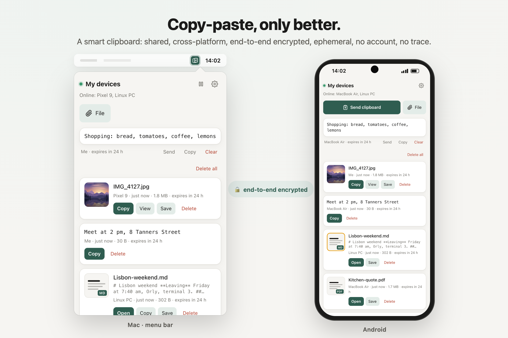
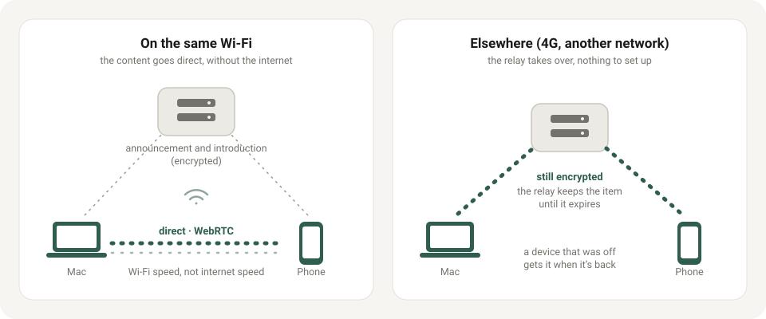

# Entre Nous
[Français](README.md)

**Copy-paste, only better.**

A smart clipboard: shared, cross-platform, end-to-end encrypted, ephemeral, no account,
no trace.

<p align="center">
  <picture>
    <source media="(prefers-color-scheme: dark)" srcset="docs/images/apercu-sombre-en.png">
    
  </picture>
</p>

- **End-to-end encrypted**: only your devices can read what you share.
- **Ephemeral**: everything is deleted automatically, after 10 minutes to 7 days, as you choose.
- **No account**: your devices pair by scanning a QR code.
- **Direct on your Wi-Fi**: on the same network, what you share goes straight from one device to
  the other, without going through the internet.
- **Text, photos, videos, files** of any size, plus a live shared note.
- **Send a folder as easily as a file.** See what's inside, download only what you want.
- **Read receipts**: see at a glance whether what you sent has reached your other devices, and whether it has been read.
- **Share and receive files with anyone**, with a simple link (or a QR code).
- **Find any text or file in a few keystrokes.**
- **Pin what you use often**: it stays at the top of the history, on all your devices.
- **Open a received link in one tap**, and show a text as a QR code for a phone outside the group:
  the Wi-Fi password for a guest.
- **Open a file without saving it**: Entre Nous downloads it for as long as you need it, then erases it.
- **Previews**: preview a photo, a PDF or a Markdown document without downloading it, and watch a video
  (even in Picture-in-Picture) or listen to an audio file while it downloads.

Try it: <https://entrenous.0xdba.dev>

## See it in action

<p align="center">
  
</p>

## Platforms

| | App | Status |
|---|---|---|
| Mac | menu bar, automatic clipboard sharing (Swift) | used daily |
| Android | native app, "Share → Entre Nous" (Capacitor) | used daily |
| iPhone, iPad | web app, added to the Home Screen | works |
| Linux | system tray, automatic sharing (Tauri): `.deb`, `.AppImage` | **new, not tested yet** |
| Windows | system tray, automatic sharing (Tauri): `.exe` installer | **new, not tested yet** |
| Browser | web app, nothing to install | works |
| Terminal | `entrenous` command, for servers, scripts and AI agents (Node.js) | **new** |

## Documentation

| | |
|---|---|
| [Using Entre Nous](docs/en/usage.md) | install, pair, send, receive, settings |
| [How it works](docs/en/how-it-works.md) | relay, local mode, pairing, removing a device, protocol (diagrams) |
| [Security](docs/en/security.md) | what the server sees, algorithms, keys, known limitations |
| [Hosting your own relay](docs/en/deployment.md) | Docker, reverse proxy (Caddy, Traefik, nginx), relay at home |
| [Command line](docs/en/cli.md) | `entrenous`: install, commands, scripts, AI agents |
| [Development](docs/en/development.md) | code layout, building each app, tests |
| [Design](BRAINSTORM.md) | decisions and the reasoning behind them (in French) |
| [What's new](CHANGELOG.en.md) | what each version brings |

## In a terminal

```sh
npm install -g https://github.com/dorianbayart/entre-nous/releases/latest/download/entrenous-cli.tgz
entrenous join 'https://entrenous.0xdba.dev/app/#p=…'   # link from Settings → Invite a device
entrenous send build/app.apk                            # lands on the phone
entrenous wait --timeout 10m                            # waits for what the phone sends
```

The `entrenous` command sends and receives files from a terminal, end-to-end encrypted like in the
app. For example:

- a server sends a file to your phone;
- a script gets the photo you just took;
- an AI agent hands you what it made.

The full guide: [docs/en/cli.md](docs/en/cli.md).

## Host your own relay in two commands

```sh
git clone https://github.com/dorianbayart/entre-nous.git && cd entre-nous
docker compose up -d --build          # http://127.0.0.1:8080, put it behind an HTTPS proxy
```

Details, proxy and settings: [docs/en/deployment.md](docs/en/deployment.md).

## How it works, in short

<p align="center">
  
</p>
<p align="center">
  
</p>

- Hybrid post-quantum key exchange (X25519 + ML-KEM-768), XChaCha20-Poly1305, Ed25519.
- One key per item, wrapped for each device; prekeys rotated daily.
- A group is nothing more than a 256-bit secret shared by its devices, passed along by QR code.

## Known limitations

- **Web app**: its code is served by the relay, so a compromised relay could serve malicious code
  to the web app. The Mac, Android, Linux and Windows apps ship their own interface.
- **iPhone**: you have to tap "Copy" to put a received item on the clipboard, and a web app doesn't
  show up in the share sheet.
- **Apps not signed** by a recognized developer (Mac app not notarized, APK outside the Play Store,
  Windows app without a certificate): the system asks you to confirm at install time.
- An interrupted upload resumes as long as the app stays open, but not after a restart.
- A device that was off when another one was removed from the group has to be paired again.

## Support the project

Entre Nous is free, with no ads and no trackers. Donations pay for the public relay's server and
fund maintenance and new features: [Liberapay](https://liberapay.com/0xdba/donate) or
[GitHub Sponsors](https://github.com/sponsors/dorianbayart).

## License

[GNU AGPL v3](LICENSE) or later. You can use, modify and redistribute Entre Nous; if you run a
modified version (a relay, for example) for other people, you must give them its source code.

## Contributing

Issues and pull requests are welcome. To report a security vulnerability, see
[SECURITY.md](SECURITY.md).
