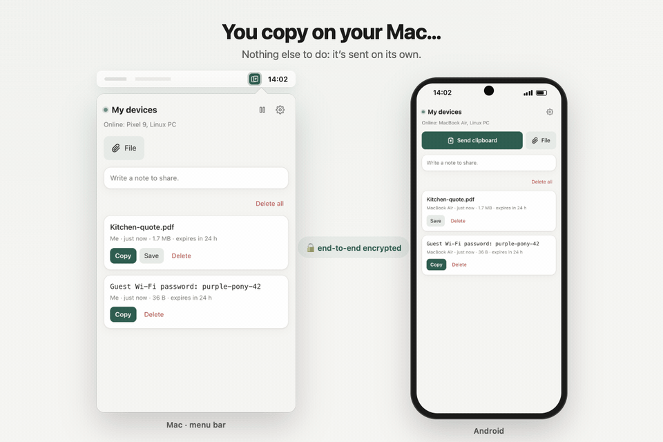

# Entre Nous
[Français](README.md)

**Copy on one device, paste on another.**

A clipboard shared across all your devices: end-to-end encrypted, ephemeral, no account,
no tracking.

<p align="center">
  <picture>
    <source media="(prefers-color-scheme: dark)" srcset="docs/images/apercu-sombre-en.png">
    
  </picture>
</p>

- **Private**: everything is encrypted on your device; the relay server only carries data it
  can't read.
- **Ephemeral**: everything is deleted automatically, after 10 minutes to 7 days depending on
  your setting.
- **No account**: your devices pair by scanning a QR code.
- **Direct** whenever possible: on the same network, content goes straight from one device to
  the other, without going through the internet.
- **Text, images, files** of any size, plus a live shared note.
- **Previews**: photos, texts and Markdown open in the app; a video plays while it arrives, and
  goes on in picture-in-picture.

Try it: <https://entrenous.0xdba.dev>

## See it in action

<p align="center">
  
</p>

## Platforms

| | App | Status |
|---|---|---|
| Mac | menu bar, automatic clipboard sharing (Swift) | used daily |
| Android | native app, "Share → Entre Nous" (Capacitor) | used daily |
| iPhone, iPad | web app, added to the Home Screen | works |
| Linux | system tray, automatic sharing (Tauri): `.deb`, `.AppImage` | **new, not tested yet** |
| Windows | system tray, automatic sharing (Tauri): `.exe` installer | **new, not tested yet** |
| Browser | web app, nothing to install | works |
| Terminal | `entrenous`, on the command line, for servers, scripts and AI agents (Node.js) | **new** |

## Documentation

| | |
|---|---|
| [Using Entre Nous](docs/en/usage.md) | install, pair, send, receive, settings |
| [How it works](docs/en/how-it-works.md) | relay, local mode, pairing, removing a device, protocol (diagrams) |
| [Security](docs/en/security.md) | what the server sees, algorithms, keys, known limitations |
| [Hosting your own relay](docs/en/deployment.md) | Docker, reverse proxy (Caddy, Traefik, nginx), relay at home |
| [Command line](docs/en/cli.md) | `entrenous`: install, commands, scripts, AI agents |
| [Development](docs/en/development.md) | code layout, building each app, tests |
| [Design](BRAINSTORM.md) | decisions and the reasoning behind them (in French) |

## In a terminal

```sh
npm install -g https://github.com/dorianbayart/entre-nous/releases/latest/download/entrenous-cli.tgz
entrenous join 'https://entrenous.0xdba.dev/app/#p=…'   # link from Settings → Invite a device
entrenous send build/app.apk                            # lands on the phone
entrenous wait --timeout 10m                            # waits for what the phone sends
```

One more device in the group, with the same end-to-end encryption: to send a file from a server,
get a photo into a script, or let an AI agent hand you what it made. It's all in
[docs/en/cli.md](docs/en/cli.md).

## Host your own relay in two commands

```sh
git clone https://github.com/dorianbayart/entre-nous.git && cd entre-nous
docker compose up -d --build          # http://127.0.0.1:8080, put it behind an HTTPS proxy
```

Details, proxy and settings: [docs/en/deployment.md](docs/en/deployment.md).

## How it works, in short

<p align="center">
  
</p>
<p align="center">
  
</p>

- Hybrid post-quantum key exchange (X25519 + ML-KEM-768), XChaCha20-Poly1305, Ed25519.
- One key per item, wrapped for each device; prekeys rotated daily.
- A group is nothing more than a 256-bit secret shared by its devices, passed along by QR code.

## Known limitations

- **Web app**: its code is served by the relay, so a compromised relay could serve malicious code
  to the web app. The Mac, Android, Linux and Windows apps ship their own interface.
- **iPhone**: writing to the clipboard takes a tap ("Copy"), and a web app can't appear in the
  share sheet.
- **Apps not signed** by a recognized developer (Mac app not notarized, APK outside the Play Store,
  Windows app without a certificate): the system asks you to confirm at install time.
- An interrupted upload resumes as long as the app stays open, but not after a restart.
- A device that was switched off while another one was removed has to be paired again.

## License

[GNU AGPL v3](LICENSE) or later. You can use, modify and redistribute Entre Nous; if you run a
modified version (a relay, for example) for other people, you must give them its source code.

## Contributing

Issues and pull requests are welcome. To report a security vulnerability, see
[SECURITY.md](SECURITY.md).
