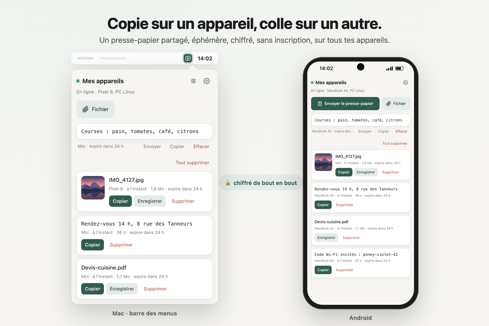
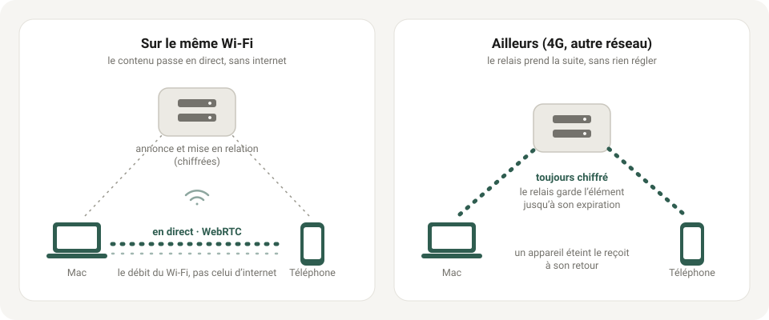

# Entre Nous
[English](README.en.md)

**Le copier-coller, en mieux.**

Un presse-papier malin, partagé, multiplateforme, chiffré de bout en bout, éphémère, sans compte,
sans trace.

<p align="center">
  <picture>
    <source media="(prefers-color-scheme: dark)" srcset="docs/images/apercu-sombre.png">
    
  </picture>
</p>

- **Chiffré de bout en bout** : seuls tes appareils peuvent lire ce que tu partages.
- **Éphémère** : tout s'efface automatiquement, après 10 minutes à 7 jours, selon ton choix.
- **Sans compte** : tes appareils s'associent en scannant un QR code.
- **En direct sur ton Wi-Fi** : sur le même réseau, ce que tu partages va directement d'un appareil
  à l'autre, sans passer par internet.
- **Textes, photos, vidéos, fichiers**, de n'importe quelle taille, et une note partagée en direct.
- **Aperçus** : prévisualise une photo ou un document Markdown sans le télécharger, et regarde une
  vidéo (même en Picture-in-Picture) ou écoute un fichier audio pendant son téléchargement.

Essayer : <https://entrenous.0xdba.dev>

## En action

<p align="center">
  
</p>

## Plateformes

| | Appli | État |
|---|---|---|
| Mac | barre des menus, partage automatique du presse-papier (Swift) | utilisée au quotidien |
| Android | appli native, « Partager → Entre Nous » (Capacitor) | utilisée au quotidien |
| iPhone, iPad | appli web à ajouter à l'écran d'accueil | fonctionne |
| Linux | zone de notification, partage automatique (Tauri) : `.deb`, `.AppImage` | **nouvelle, pas encore testée** |
| Windows | zone de notification, partage automatique (Tauri) : installeur `.exe` | **nouvelle, pas encore testée** |
| Navigateur | appli web, rien à installer | fonctionne |
| Terminal | commande `entrenous`, pour les serveurs, les scripts et les agents d'IA (Node.js) | **nouveau** |

## Documentation

| | |
|---|---|
| [Utiliser Entre Nous](docs/utilisation.md) | installer, associer, envoyer, recevoir, réglages |
| [Comment ça marche](docs/fonctionnement.md) | relais, mode local, association, retrait d'un appareil, protocole (schémas) |
| [Sécurité](docs/securite.md) | ce que voit le serveur, algorithmes, clés, limites connues |
| [Héberger son relais](docs/deploiement.md) | Docker, reverse proxy (Caddy, Traefik, nginx), relais à la maison |
| [En ligne de commande](docs/cli.md) | `entrenous` : installer, commandes, scripts, agents d'IA |
| [Développement](docs/developpement.md) | structure du code, compiler chaque appli, tests |
| [Conception](BRAINSTORM.md) | décisions et leur raison d'être |
| [Nouveautés](CHANGELOG.md) | ce que chaque version apporte |

## Dans un terminal

```sh
npm install -g https://github.com/dorianbayart/entre-nous/releases/latest/download/entrenous-cli.tgz
entrenous join 'https://entrenous.0xdba.dev/app/#p=…'   # lien de Réglages → Inviter un appareil
entrenous send build/app.apk                            # arrive sur le téléphone
entrenous wait --timeout 10m                            # attend ce que le téléphone envoie
```

La commande `entrenous` envoie et reçoit des fichiers depuis un terminal, chiffrés de bout en bout
comme dans l'appli. Par exemple :

- un serveur t'envoie un fichier sur ton téléphone ;
- un script récupère la photo que tu viens de prendre ;
- un agent d'IA te transmet ce qu'il a produit.

Le guide complet : [docs/cli.md](docs/cli.md).

## Héberger son relais en deux commandes

```sh
git clone https://github.com/dorianbayart/entre-nous.git && cd entre-nous
docker compose up -d --build          # http://127.0.0.1:8080, à mettre derrière un proxy HTTPS
```

Détails, proxy et réglages : [docs/deploiement.md](docs/deploiement.md).

## Comment ça marche, en bref

<p align="center">
  
</p>
<p align="center">
  
</p>

- Échange de clés hybride post-quantique (X25519 + ML-KEM-768), XChaCha20-Poly1305, Ed25519.
- Une clé par élément, enveloppée pour chaque appareil ; pré-clés renouvelées chaque jour.
- Le groupe n'est qu'un secret de 256 bits partagé par ses appareils, transmis par QR code.

## Limites connues

- **Appli web** : son code est servi par le relais ; un relais compromis pourrait servir un code
  malveillant à l'appli web. Les applis Mac, Android, Linux et Windows embarquent leur interface.
- **iPhone** : il faut toucher « Copier » pour mettre un élément reçu dans le presse-papier, et une
  appli web n'apparaît pas dans le menu « Partager ».
- **Applis non signées** par un éditeur reconnu (Mac non notariée, APK hors Play Store, Windows
  sans certificat) : le système demande une confirmation à l'installation.
- Un envoi interrompu reprend tant que l'appli reste ouverte, pas après son redémarrage.
- Un appareil éteint au moment où un autre est retiré du groupe doit être associé de nouveau.

## Licence

[GNU AGPL v3](LICENSE) ou ultérieure. Tu peux utiliser, modifier et redistribuer Entre Nous ;
si tu fais tourner une version modifiée (un relais, par exemple) pour d'autres personnes, tu dois
leur en donner le code source.

## Contribuer

Les issues et les pull requests sont bienvenues. Pour une faille de sécurité, voir
[SECURITY.md](SECURITY.md).
