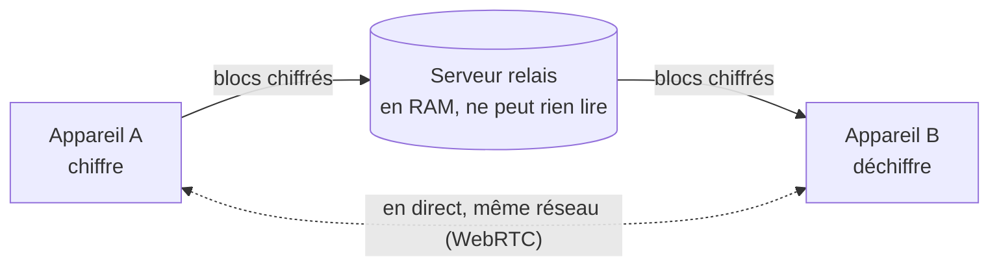

# Entre Nous

**Copie sur un appareil, colle sur un autre.**

Un presse-papier commun à tous tes appareils, chiffré de bout en bout, éphémère, sans compte,
sans pistage.

- **Confidentiel** : tout est chiffré sur ton appareil ; le serveur relais ne transporte que des
  données qu'il ne peut pas lire.
- **Éphémère** : tout s'efface automatiquement, au bout de 10 minutes à 7 jours selon ton réglage.
- **Sans compte** : tes appareils s'associent en scannant un QR code.
- **En direct** quand c'est possible : sur le même réseau, le contenu passe d'un appareil à l'autre
  sans passer par internet.
- **Textes, images, fichiers**, de n'importe quelle taille, et une note partagée en direct.

Essayer : <https://entrenous.0xdba.dev>

## Plateformes

| | Appli | État |
|---|---|---|
| Mac | barre des menus, partage automatique du presse-papier (Swift) | utilisée au quotidien |
| Android | appli native, « Partager → Entre Nous » (Capacitor) | utilisée au quotidien |
| iPhone, iPad | appli web à ajouter à l'écran d'accueil | fonctionne |
| Linux | zone de notification, partage automatique (Tauri) : `.deb`, `.AppImage` | **nouvelle, pas encore testée** |
| Windows | zone de notification, partage automatique (Tauri) : installeur `.exe` | **nouvelle, pas encore testée** |
| Navigateur | appli web, rien à installer | fonctionne |

## Documentation

| | |
|---|---|
| [Utiliser Entre Nous](docs/utilisation.md) | installer, associer, envoyer, recevoir, réglages |
| [Comment ça marche](docs/fonctionnement.md) | relais, mode local, association, retrait d'un appareil, protocole (schémas) |
| [Sécurité](docs/securite.md) | ce que voit le serveur, algorithmes, clés, limites connues |
| [Héberger son relais](docs/deploiement.md) | Docker, reverse proxy (Caddy, Traefik, nginx), relais à la maison |
| [Développement](docs/developpement.md) | structure du code, compiler chaque appli, tests |
| [Conception](BRAINSTORM.md) | décisions et leur raison d'être |

## Héberger son relais en deux commandes

```sh
git clone https://github.com/dorianbayart/entre-nous.git && cd entre-nous
docker compose up -d --build          # http://127.0.0.1:8080, à mettre derrière un proxy HTTPS
```

Détails, proxy et réglages : [docs/deploiement.md](docs/deploiement.md).

## Comment ça marche, en bref



- Échange de clés hybride post-quantique (X25519 + ML-KEM-768), XChaCha20-Poly1305, Ed25519.
- Une clé par élément, enveloppée pour chaque appareil ; pré-clés renouvelées chaque jour.
- Le groupe n'est qu'un secret de 256 bits partagé par ses appareils, transmis par QR code.

## Limites connues

- **Appli web** : son code est servi par le relais ; un relais compromis pourrait servir un code
  malveillant à l'appli web. Les applis Mac, Android, Linux et Windows embarquent leur interface.
- **iPhone** : écrire dans le presse-papier demande un toucher (« Copier »), et pas de
  « Partager vers » pour une appli web.
- **Applis non signées** par un éditeur reconnu (Mac non notariée, APK hors Play Store, Windows
  sans certificat) : le système demande une confirmation à l'installation.
- Un envoi interrompu reprend tant que l'appli reste ouverte, pas après son redémarrage.
- Un appareil resté éteint pendant le retrait d'un autre doit être associé de nouveau.

## Contribuer

Les issues et les pull requests sont bienvenues. Pour une faille de sécurité, voir
[SECURITY.md](SECURITY.md).
