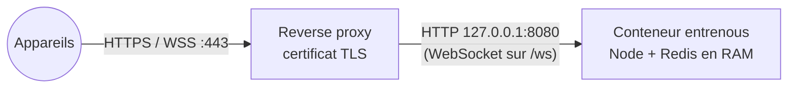

# Héberger son propre serveur relais

Le relais est un seul conteneur Docker (Node + Redis en mémoire). Il sert aussi la page d'accueil,
l'appli web (`/app/`) et les applis à télécharger (`/download/…`). Il ne voit que des données
chiffrées (voir [securite.md](securite.md)), mais l'héberger soi-même permet de ne dépendre de
personne et de garder les métadonnées (adresses IP, heures d'envoi) chez soi.

- [Ce qu'il faut](#ce-quil-faut)
- [Démarrer le relais](#démarrer-le-relais)
- [HTTPS : le reverse proxy](#https--le-reverse-proxy)
- [Réglages](#réglages)
- [Faire pointer les applis sur ton relais](#faire-pointer-les-applis-sur-ton-relais)
- [Proposer les applis au téléchargement](#proposer-les-applis-au-téléchargement)
- [Un relais à la maison](#un-relais-à-la-maison)
- [Mettre à jour](#mettre-à-jour)

## Ce qu'il faut

- Une machine avec Docker et Docker Compose : un petit VPS, un NAS, un Raspberry Pi (le relais
  tourne aussi sur ARM).
- Un nom de domaine et **HTTPS** avec un vrai certificat : sans contexte sécurisé, les téléphones
  n'ont ni caméra (scanner le QR code), ni presse-papier, ni appli installable.
- De la mémoire pour les contenus en attente : tout vit en RAM. 4 Go conviennent à un usage
  personnel ou familial ; c'est la limite qui borne l'espace disponible.



## Démarrer le relais

```sh
git clone https://github.com/dorianbayart/entre-nous.git
cd entre-nous
docker compose up -d --build
curl http://127.0.0.1:8080/healthz      # → ok
```

Le `docker-compose.yml` du dépôt publie le relais sur `127.0.0.1:8080` seulement : il attend un
reverse proxy devant lui. Il durcit aussi le conteneur (lecture seule, aucune capacité, pas
d'élévation de privilèges, `mem_limit: 4g`).

## HTTPS : le reverse proxy

Le proxy doit transmettre le **WebSocket** (`/ws`) et l'adresse du client dans `X-Forwarded-For`
(le relais limite à 32 connexions par adresse IP : sans elle, tous les appareils sembleraient venir
du proxy). Ne laisse pas un client fournir son propre `X-Forwarded-For` : le relais en prend la
première valeur.

### Caddy (le plus simple : certificat automatique)

```caddy
entrenous.example.org {
    reverse_proxy 127.0.0.1:8080
}
```

Caddy gère le WebSocket et remplace `X-Forwarded-For` par l'adresse du client.

### Traefik (labels Docker)

Retire `ports:` du compose et branche le conteneur sur le réseau de Traefik :

```yaml
services:
  entrenous:
    # … comme dans docker-compose.yml, sans « ports: »
    networks: [frontend]
    labels:
      - traefik.enable=true
      - traefik.http.routers.entrenous.rule=Host(`entrenous.example.org`)
      - traefik.http.routers.entrenous.entrypoints=websecure
      - traefik.http.routers.entrenous.tls.certresolver=letsencrypt
      - traefik.http.services.entrenous.loadbalancer.server.port=8080
networks:
  frontend:
    external: true
```

### nginx

```nginx
server {
    listen 443 ssl http2;
    server_name entrenous.example.org;
    ssl_certificate     /etc/letsencrypt/live/entrenous.example.org/fullchain.pem;
    ssl_certificate_key /etc/letsencrypt/live/entrenous.example.org/privkey.pem;

    location / {
        proxy_pass http://127.0.0.1:8080;
        proxy_http_version 1.1;
        proxy_set_header Upgrade $http_upgrade;
        proxy_set_header Connection "upgrade";
        proxy_set_header Host $host;
        proxy_set_header X-Forwarded-For $remote_addr;   # l'adresse réelle, pas celle annoncée par le client
        proxy_read_timeout 1h;
        proxy_buffering off;
    }
}
```

## Réglages

Variables d'environnement du conteneur (dans `docker-compose.yml`) :

| Variable | Défaut | Rôle |
|---|---|---|
| `MAX_STORAGE` | `0` | quota total des contenus (`500m`, `2g`…), `0` = illimité, borné par la mémoire |
| `MAX_TTL` | `7d` | durée de conservation maximale qu'un groupe peut choisir |
| `PERSIST` | `false` | `true` + un volume sur `/data` : l'historique survit aux redémarrages |
| `PORT` | `8080` | port d'écoute dans le conteneur |

- **Mémoire** : Redis prend 80 % de `mem_limit` et refuse les nouveaux envois au-delà (les applis
  affichent « Serveur saturé ») plutôt que de faire tuer le conteneur. L'espace restant est affiché
  dans les réglages des applis.
- **Persistance** : par défaut, rien n'est écrit sur disque et un redémarrage vide le relais. Les
  associations ne sont pas perdues (elles vivent sur les appareils, qui republient l'état du groupe
  à la connexion) ; seul l'historique en attente disparaît. Avec `PERSIST=true`, décommente le volume
  dans le compose ; `docker compose down -v` efface tout.
- **Journaux** : le relais n'écrit ni contenu ni identifiant de salle. Configure ton proxy dans le
  même esprit si tu veux éviter de garder les adresses IP.

## Faire pointer les applis sur ton relais

Un groupe appartient à un relais : c'est celui de l'appareil qui l'a créé, et il est inscrit dans
le lien d'invitation. **Un appareil qui rejoint par un QR code de ton relais utilise donc ton relais
pour ce groupe**, quelle que soit sa configuration. Il suffit que le premier appareil crée le groupe
sur ton relais.

**Dans les applis Mac, Android, Linux et Windows** : **Réglages → Serveur → Adresse du serveur**,
puis **Changer de serveur**. L'appli vérifie que le serveur répond, puis :

- les groupes créés ensuite le sont sur ce serveur ;
- un groupe où l'appareil est seul (le groupe « Mes appareils » créé au premier lancement) y passe
  aussitôt ;
- un groupe déjà partagé avec d'autres appareils reste sur son serveur.

Un champ vide ramène au serveur par défaut. **L'appli web**, elle, utilise toujours le relais qui la
sert (`https://entrenous.example.org/app/`).

Le serveur par défaut peut aussi être choisi à la compilation ou sans ouvrir l'appli :

| Appli | Serveur par défaut |
|---|---|
| Mac | `RELAY=https://… macos/build-app.sh`, ou `defaults write dev.0xdba.entrenous relay https://…` |
| Linux, Windows | `ENTRENOUS_RELAY=https://… desktop/build.sh` ; ou, au lancement, la variable `ENTRENOUS_RELAY` ou un fichier `relay` dans `~/.config/dev.xdba.entrenous/` (Linux), `%APPDATA%\dev.xdba.entrenous\` (Windows) |
| Android | `web/src/platform/android.ts`, avant `android/build.sh` |

Les applis exigent un relais en HTTPS (sauf `http://127.0.0.1` pour le développement).

## Proposer les applis au téléchargement

L'image Docker copie le dossier `downloads/` dans `/download/` : c'est là que pointent les boutons
de la page d'accueil. Compile les applis avant de construire l'image (voir
[developpement.md](developpement.md)) :

```sh
UNIVERSAL=1 macos/build-app.sh   # downloads/Entre-Nous-mac.zip   (sur un Mac)
android/build.sh                 # downloads/Entre-Nous-android.apk (Docker)
desktop/build.sh                 # downloads/Entre-Nous-linux.deb, .AppImage, Entre-Nous-windows.exe (Docker)
docker compose up -d --build
```

L'APK Android doit être signé par ta propre clé (créée au premier `android/build.sh`) ; son empreinte
est publiée dans `/.well-known/assetlinks.json` pour que les liens d'invitation ouvrent l'appli.

## Un relais à la maison

Possible sur un NAS ou un Raspberry Pi, avec deux contraintes :

- **HTTPS avec un certificat reconnu**, même en local. Le plus simple : un nom de domaine et un
  certificat obtenu par défi DNS (Caddy avec le module de ton registrar, Traefik), ou
  [Tailscale](https://tailscale.com/kb/1153/enabling-https) (`tailscale serve`), qui fournit une
  adresse HTTPS joignable par tes appareils où qu'ils soient.
- **Joignable de l'extérieur** si tu veux partager hors de chez toi : redirection du port 443 de la
  box, ou réseau privé (Tailscale, WireGuard). Sinon, le partage ne marche qu'à la maison.

Les transferts directs du mode local n'en dépendent pas : ils passent de toute façon d'un appareil
à l'autre ; le relais ne sert alors qu'aux annonces et à la mise en relation.

## Mettre à jour

```sh
git pull
docker compose up -d --build
```

Sans `PERSIST`, la mise à jour vide le relais (l'historique en attente est perdu, les groupes
restent).
