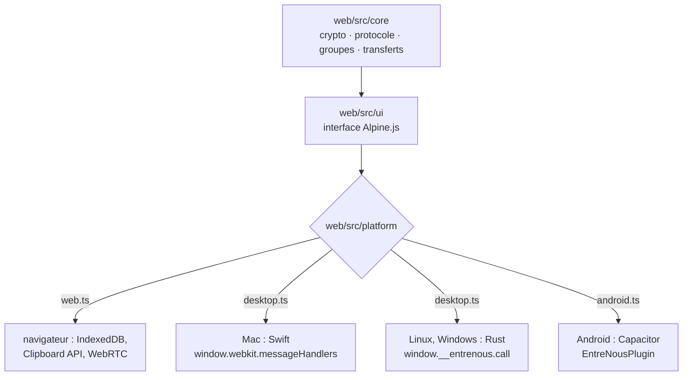

# Développement
[English](en/development.md)

Les choix de conception et leur historique sont dans [BRAINSTORM.md](../BRAINSTORM.md).

## Structure

| Dossier | Contenu |
|---|---|
| `web/` | cœur TypeScript (`src/core/` : crypto, protocole, groupes, transferts, mode local), interface Alpine.js en build CSP (`src/ui/`), ponts vers les applis (`src/platform/`), page d'accueil |
| `relay/` | relais Node + Redis (en RAM) ; sert aussi la page d'accueil, l'appli web et les téléchargements |
| `macos/` | appli de barre des menus (Swift + WKWebView) |
| `desktop/` | appli Linux et Windows (Rust + Tauri, WebKitGTK / WebView2) |
| `android/` | appli Android (Capacitor 8), plugin natif `EntreNousPlugin.java` |
| `cli/` | la ligne de commande `entrenous` (Node), sur le même cœur ; un seul fichier, `dist/entrenous.mjs` |
| `downloads/` | applis compilées en local (non versionnées) |
| `scripts/auto-update.sh` | mise à jour automatique d'un relais sur la dernière release |
| `Dockerfile`, `docker-compose.yml` | le relais en un seul conteneur |

Toutes les applis embarquent la même interface (`web/dist/app`) et parlent au même cœur ; chacune
n'ajoute qu'un pont natif (stockage des clés, presse-papier, fichiers) :



Le cœur ne dépend pas du DOM : il tourne aussi dans Node, pour les tests.

## Appli web et relais

```sh
docker compose up -d --build     # relais sur http://127.0.0.1:8080 (page d'accueil, /app/)
cd web
npm install
npm run build                    # dist/ : page d'accueil (/) et appli web (/app/)
npm run dev                      # build en continu
npm run typecheck
npm test                         # le relais doit tourner (RELAY=https://… pour un autre)
npm run test:ui                  # interface, dans Chrome (HEADED=1 pour la voir)
```

Les tests lancent de vrais appareils (moteurs) contre le relais : association, envois, reprise après
coupure, suppression pendant un envoi, retrait d'un appareil, mode local (avec une liaison en mémoire
à la place de WebRTC, absent de Node).

Les images de la documentation (`docs/images/`) se refont avec `npm run screenshots` (relais lancé,
Chrome et ffmpeg) : trois appareils de démonstration dans Chrome, dont un Mac dont le pont natif est
simulé ; captures, mises en scène et animation. Il refait aussi celles de la page d'accueil du relais
(`web/public/images/` : les trois appareils en clair et en sombre, l'animation en WebP). Il tourne
en français puis en anglais : les images anglaises finissent par `-en`
(`node scripts/screenshots.mjs en` pour une seule langue). Les schémas SVG (`chiffrement.svg`,
`reseau.svg` et leurs versions `-en.svg`) sont écrits à la main ; la page d'accueil les reprend,
copiés à la construction (`build.mjs`).

### Langues

L'interface existe en français et en anglais : la langue du système ou du navigateur (l'anglais
pour toute autre langue), ou celle choisie dans Réglages → Langue. Les textes sont dans
`web/src/i18n/fr.ts` et `en.ts` (mêmes clés, vérifiées par `npm run typecheck`) ; le HTML les
affiche par `x-text="t('clé')"`, et `x-rich` pour un peu de mise en forme (`**gras**`, saut de ligne).
Les applis de bureau reçoivent la langue de l'interface (`setLang`) pour le menu de leur icône.

La page d'accueil existe en deux fichiers, `web/public/index.html` (français) et
`web/public/en/index.html` : `/` sert l'une ou l'autre selon `Accept-Language`, `/fr/` et `/en/`
les servent directement. La documentation anglaise est dans `docs/en/` et `README.en.md`.

Les tests d'interface (`test/ui/`) ouvrent l'appli servie par le relais dans plusieurs profils Chrome
(un par appareil, dont un téléphone Android simulé) : note, confirmations, envoi en cours et
téléchargements, invitations, retrait. Ils utilisent le Chrome installé (`playwright-core`, aucun
navigateur téléchargé) ; le relais doit avoir été reconstruit avec l'appli à tester.

## Ligne de commande

```sh
cd web && npm install                  # le cœur et ses paquets (@noble…)
cd ../cli && npm install
npm run build                          # dist/entrenous.mjs : un seul fichier, sans dépendance
npm run typecheck
npm test                               # deux terminaux contre le relais lancé (RELAY=… pour un autre)
node dist/entrenous.mjs --help
ENTRENOUS_RELAY=http://127.0.0.1:8080 ENTRENOUS_HOME=/tmp/en node dist/entrenous.mjs create
```

- Même cœur que les applis (`web/src/core`), regroupé par esbuild avec le CLI. La plateforme `cli`
  s'affiche « Terminal » dans la liste des appareils.
- Clés dans des fichiers (`src/store.ts`) : verrou pour les écritures, et fusion des prékeys quand
  deux processus de la même identité écrivent le même groupe.
- Textes en français et en anglais dans `src/i18n.ts` (le compilateur vérifie que les deux ont les
  mêmes clés) ; la langue suit `LANG`.
- `npm run test:ui` (dans `web/`) a aussi un test terminal + navigateur, quand le CLI est compilé.

## Appli Mac

```sh
cd macos
./build-app.sh                                 # → build/Entre Nous.app
UNIVERSAL=1 ./build-app.sh                     # Apple + Intel, et downloads/Entre-Nous-mac.zip
RELAY=http://127.0.0.1:8080 ./build-app.sh     # relais local
open "build/Entre Nous.app"
```

- Outils : Swift (Xcode ou Command Line Tools), macOS 14 ou plus récent.
- Clés dans le Trousseau, en une seule entrée (`dev.0xdba.entrenous` / `store`).
- Signature : `./signing-identity.sh` (une fois par Mac) crée un certificat local « Entre Nous » ;
  sans lui, la signature est ad hoc et chaque recompilation redemande l'accès au Trousseau.
- Relais : `defaults write dev.0xdba.entrenous relay <url>`.

## Appli Linux et Windows

```sh
desktop/build.sh                     # Linux (.deb, .AppImage) et Windows (installeur .exe)
TARGETS=linux desktop/build.sh       # un seul des deux
ENTRENOUS_RELAY=https://… desktop/build.sh
```

- Compilation dans Docker (image `desktop/docker`, Ubuntu 22.04 pour une glibc assez ancienne) :
  rien à installer sur la machine. Windows est compilé de façon croisée avec
  [cargo-xwin](https://github.com/rust-cross/cargo-xwin), qui télécharge une fois le CRT et le SDK
  de Microsoft (leur licence s'applique), et empaqueté avec NSIS.
- L'image est en `linux/amd64` : émulée sur un Mac à puce Apple, la première compilation prend du temps.
- Sans Docker, sur la machine cible : les [prérequis de Tauri](https://v2.tauri.app/start/prerequisites/),
  puis `cargo install tauri-cli` et `cd desktop/src-tauri && cargo tauri build`.
- Pont natif (`desktop/src-tauri/src/`) : `store.rs` (fichier chiffré, clé dans le trousseau du
  système), `clip.rs` (surveillance du presse-papier), `files.rs` (fichiers reçus), `main.rs`
  (fenêtre, icône, appels de l'interface). Mêmes appels que l'appli Mac (`web/src/platform/desktop.ts`).
- Fermer la fenêtre garde l'appli active dans la zone de notification ; **Quitter** est dans le menu
  de l'icône. `--hidden` la lance directement dans la zone de notification.
- Linux : presse-papier X11 (sous Wayland, via XWayland). Sous GNOME, l'icône demande l'extension
  AppIndicator ; sans elle, relancer l'appli ramène sa fenêtre.
- La CI GitHub (`.github/workflows/apps.yml`) compile les quatre applis (Linux, Windows, Android,
  Mac) à chaque push sur `master`, sauf quand seule la documentation change, puis les publie comme
  dernière release GitHub (la seule gardée). Voir [Versions et releases](#versions-et-releases).

## Appli Android

```sh
android/build.sh          # APK signé → downloads/Entre-Nous-android.apk (Docker)
```

- Compilation dans Docker (JDK 21 + SDK Android), en `linux/amd64`.
- Clé de signature hors du dépôt, dans `~/.config/entrenous/` (créée au premier build) :
  **à sauvegarder**, une mise à jour doit être signée par la même clé. Ne jamais la committer.
- Son empreinte est publiée dans `web/public/.well-known/assetlinks.json` (généré) : les liens
  d'invitation ouvrent l'appli.
- Relais inscrit dans `web/src/platform/android.ts`.

## Versions et releases

- Version d'un build : `0.1.<nombre de commits>` (`git rev-list --count HEAD`), la même pour toutes
  les applis compilées depuis un commit ; `APP_VERSION` la remplace. Elle est inscrite dans
  l'interface (`__VERSION__`, `web/build.mjs`), l'appli Mac, l'APK (`versionCode` = nombre de commits)
  et les applis Tauri.
- La CI publie la release `v0.1.N` avec des noms de fichiers fixes (`Entre-Nous-mac.zip`,
  `Entre-Nous-android.apk`, `Entre-Nous-windows.exe`, `Entre-Nous-linux.deb`,
  `Entre-Nous-linux.AppImage`, `entrenous-cli.tgz`) et supprime les précédentes.
- L'APK est signé avec les secrets `ANDROID_KEYSTORE` (le `.jks` en base64) et
  `ANDROID_KEYSTORE_PASSWORD` ; sans eux, la release n'est pas publiée. L'appli Mac a une signature
  ad hoc.
- Les relais annoncent la dernière release aux applis (champ `latest` de la réponse à `hello`) ;
  une appli plus ancienne affiche « Nouvelle version disponible ».

### Nouveautés (changelog)

- `CHANGELOG.md` (français) et `CHANGELOG.en.md` (anglais), à la main : une section
  `## 0.1.N — AAAA-MM-JJ` par version qui change quelque chose pour l'utilisateur, une ligne `- `
  par changement (suite indentée, `**gras**` et `` `code` `` permis). Les versions sans changement
  visible n'y sont pas ; rien sur l'infrastructure.
- **Une phrase courte, en français courant, qui dit ce que l'utilisateur y gagne**, pas comment la
  fonction marche : « Les vidéos démarrent sans attendre la fin du téléchargement. »
- **L'entrée s'écrit dans le commit de l'évolution**, avec la version de ce commit :
  `node scripts/changelog.mjs next`. `node scripts/changelog.mjs check` (aussi en CI) vérifie les deux
  fichiers : mêmes versions, mêmes dates, même nombre de lignes, aucune version au-delà du prochain
  commit.
- Où ça se lit :
  - **dans les applis** : le build (`web/build.mjs`) intègre le changelog au code ; après une mise à
    jour, l'appli affiche une fois ce qu'apportent les versions depuis la dernière utilisée ;
  - **avant une mise à jour** : la CI joint `changelog.json` à la release ; le relais le récupère avec
    la release (sinon il garde sa propre copie, `app/changelog.json`) et répond à l'opération
    `changelog { since }` ; le bandeau « Nouvelle version » propose « Nouveautés » ;
  - **sur le site** : `/nouveautes/` et `/en/changelog/`, générées au build ;
  - **sur GitHub** : les fichiers, et les notes de chaque release (les versions depuis la précédente).

## Règles du code

- Le cœur (`web/src/core/`) ne touche pas au DOM.
- Interface en Alpine.js **build CSP** : pas d'`eval`, donc pas de fonction fléchée ni de template
  literal dans les attributs HTML ; passer par des méthodes.
- Protocole : requêtes `{ rid, op, … }`, réponses `{ rid, ok, … }`, évènements `{ ev, … }` ;
  `rid` n'est jamais un champ métier.
- Le relais ne journalise jamais de contenu ni d'identifiant de salle.
- Images Docker de base sans version figée (`node:lts-alpine`, `ubuntu:jammy`…).
- Textes de l'interface en français et en anglais naturels, sans jargon technique ; tout nouveau
  texte va dans les deux dictionnaires (`web/src/i18n/`).
- Ne jamais appeler `t` une variable de boucle (`x-for`) : elle masquerait la méthode `t()`.
