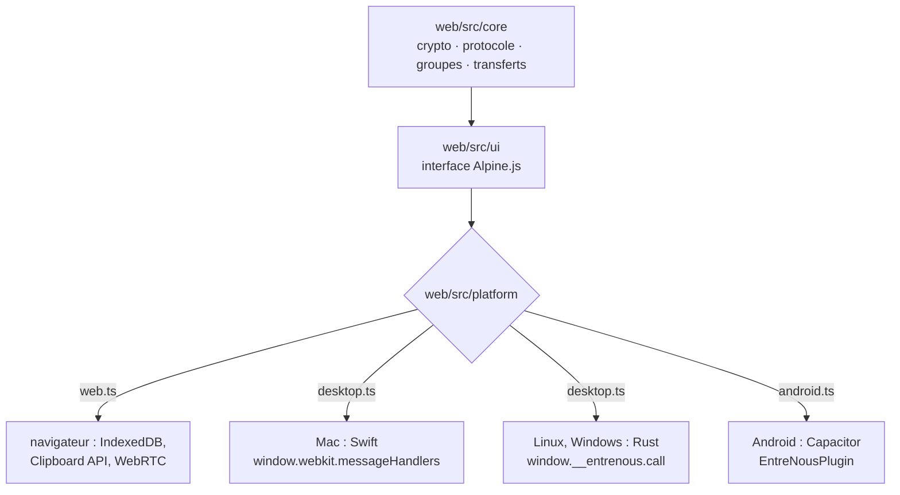

# Développement

Les choix de conception et leur historique sont dans [BRAINSTORM.md](../BRAINSTORM.md).

## Structure

| Dossier | Contenu |
|---|---|
| `web/` | cœur TypeScript (`src/core/` : crypto, protocole, groupes, transferts, mode local), interface Alpine.js en build CSP (`src/ui/`), ponts vers les applis (`src/platform/`), page d'accueil |
| `relay/` | relais Node + Redis (en RAM) ; sert aussi la page d'accueil, l'appli web et les téléchargements |
| `macos/` | appli de barre des menus (Swift + WKWebView) |
| `desktop/` | appli Linux et Windows (Rust + Tauri, WebKitGTK / WebView2) |
| `android/` | appli Android (Capacitor 8), plugin natif `EntreNousPlugin.java` |
| `downloads/` | applis compilées proposées par la page d'accueil (non versionnées) |
| `Dockerfile`, `docker-compose.yml` | le relais en un seul conteneur |

Toutes les applis embarquent la même interface (`web/dist/app`) et parlent au même cœur ; chacune
n'ajoute qu'un pont natif (stockage des clés, presse-papier, fichiers) :



Le cœur ne dépend pas du DOM : il tourne aussi dans Node, pour les tests.

## Appli web et relais

```sh
docker compose up -d --build     # relais sur http://127.0.0.1:8080 (page d'accueil, /app/)
cd web
npm install
npm run build                    # dist/ : page d'accueil (/) et appli web (/app/)
npm run dev                      # build en continu
npm run typecheck
npm test                         # le relais doit tourner (RELAY=https://… pour un autre)
```

Les tests lancent de vrais appareils (moteurs) contre le relais : association, envois, reprise après
coupure, suppression pendant un envoi, retrait d'un appareil, mode local (avec une liaison en mémoire
à la place de WebRTC, absent de Node).

## Appli Mac

```sh
cd macos
./build-app.sh                                 # → build/Entre Nous.app
UNIVERSAL=1 ./build-app.sh                     # Apple + Intel, et downloads/Entre-Nous-mac.zip
RELAY=http://127.0.0.1:8080 ./build-app.sh     # relais local
open "build/Entre Nous.app"
```

- Outils : Swift (Xcode ou Command Line Tools), macOS 14 ou plus récent.
- Clés dans le Trousseau, en une seule entrée (`dev.0xdba.entrenous` / `store`).
- Signature : `./signing-identity.sh` (une fois par Mac) crée un certificat local « Entre Nous » ;
  sans lui, la signature est ad hoc et chaque recompilation redemande l'accès au Trousseau.
- Relais : `defaults write dev.0xdba.entrenous relay <url>`.

## Appli Linux et Windows

```sh
desktop/build.sh                     # Linux (.deb, .AppImage) et Windows (installeur .exe)
TARGETS=linux desktop/build.sh       # un seul des deux
ENTRENOUS_RELAY=https://… desktop/build.sh
```

- Compilation dans Docker (image `desktop/docker`, Ubuntu 22.04 pour une glibc assez ancienne) :
  rien à installer sur la machine. Windows est compilé de façon croisée avec
  [cargo-xwin](https://github.com/rust-cross/cargo-xwin), qui télécharge une fois le CRT et le SDK
  de Microsoft (leur licence s'applique), et empaqueté avec NSIS.
- L'image est en `linux/amd64` : émulée sur un Mac à puce Apple, la première compilation prend du temps.
- Sans Docker, sur la machine cible : les [prérequis de Tauri](https://v2.tauri.app/start/prerequisites/),
  puis `cargo install tauri-cli` et `cd desktop/src-tauri && cargo tauri build`.
- Pont natif (`desktop/src-tauri/src/`) : `store.rs` (fichier chiffré, clé dans le trousseau du
  système), `clip.rs` (surveillance du presse-papier), `files.rs` (fichiers reçus), `main.rs`
  (fenêtre, icône, appels de l'interface). Mêmes appels que l'appli Mac (`web/src/platform/desktop.ts`).
- Fermer la fenêtre garde l'appli active dans la zone de notification ; **Quitter** est dans le menu
  de l'icône. `--hidden` la lance directement dans la zone de notification.
- Linux : presse-papier X11 (sous Wayland, via XWayland). Sous GNOME, l'icône demande l'extension
  AppIndicator ; sans elle, relancer l'appli ramène sa fenêtre.
- La CI GitHub (`.github/workflows/apps.yml`) compile les quatre applis (Linux, Windows, Android,
  Mac) à chaque push sur `master`, sauf quand seule la documentation change. Les paquets restent
  un jour en pièce jointe du build. Sans les secrets `ANDROID_KEYSTORE` (le `.jks` en base64) et
  `ANDROID_KEYSTORE_PASSWORD`, l'APK de la CI n'est pas signé.

## Appli Android

```sh
android/build.sh          # APK signé → downloads/Entre-Nous-android.apk (Docker)
```

- Compilation dans Docker (JDK 21 + SDK Android), en `linux/amd64`.
- Clé de signature hors du dépôt, dans `~/.config/entrenous/` (créée au premier build) :
  **à sauvegarder**, une mise à jour doit être signée par la même clé. Ne jamais la committer.
- Son empreinte est publiée dans `web/public/.well-known/assetlinks.json` (généré) : les liens
  d'invitation ouvrent l'appli.
- Relais inscrit dans `web/src/platform/android.ts`.

## Règles du code

- Le cœur (`web/src/core/`) ne touche pas au DOM.
- Interface en Alpine.js **build CSP** : pas d'`eval`, donc pas de fonction fléchée ni de template
  literal dans les attributs HTML ; passer par des méthodes.
- Protocole : requêtes `{ rid, op, … }`, réponses `{ rid, ok, … }`, évènements `{ ev, … }` ;
  `rid` n'est jamais un champ métier.
- Le relais ne journalise jamais de contenu ni d'identifiant de salle.
- Images Docker de base sans version figée (`node:lts-alpine`, `ubuntu:jammy`…).
- Textes de l'interface en français naturel, sans jargon technique.
