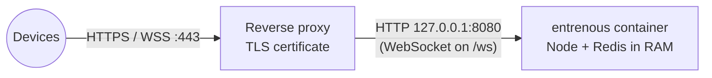

# Hosting your own relay server
[Français](../deploiement.md)

The relay is a single Docker container (Node + Redis in memory). It also serves the home page and
the web app (`/app/`); the apps are downloaded from the GitHub releases. It only ever sees
encrypted data (see [security.md](security.md)), but hosting it yourself means you don't depend
on anyone and you keep the metadata (IP addresses, send times) to yourself.

- [What you need](#what-you-need)
- [Starting the relay](#starting-the-relay)
- [HTTPS: the reverse proxy](#https-the-reverse-proxy)
- [Settings](#settings)
- [Pointing the apps at your relay](#pointing-the-apps-at-your-relay)
- [The downloadable apps](#the-downloadable-apps)
- [A relay at home](#a-relay-at-home)
- [Updating](#updating)

## What you need

- A machine with Docker and Docker Compose: a small VPS, a NAS, a Raspberry Pi (the relay runs
  on ARM too).
- A domain name and **HTTPS** with a real certificate: without a secure context, phones get no
  camera (to scan the QR code), no clipboard, and no installable app.
- Enough memory for pending content: everything lives in RAM. 4 GB is plenty for personal or
  family use; that limit is what caps the available space.



## Starting the relay

```sh
git clone https://github.com/dorianbayart/entre-nous.git
cd entre-nous
docker compose up -d --build
curl http://127.0.0.1:8080/healthz      # → ok
```

The repository's `docker-compose.yml` publishes the relay on `127.0.0.1:8080` only: it expects a
reverse proxy in front of it. It also hardens the container (read-only, no capabilities, no
privilege escalation, `mem_limit: 4g`).

## HTTPS: the reverse proxy

The proxy must pass the **WebSocket** (`/ws`) through, along with the client's address in
`X-Forwarded-For` (the relay allows 32 connections per IP address: without it, every device would
appear to come from the proxy). Don't let a client supply its own `X-Forwarded-For`: the relay
uses its first value.

### Caddy (the simplest: automatic certificate)

```caddy
entrenous.example.org {
    reverse_proxy 127.0.0.1:8080
}
```

Caddy handles the WebSocket and replaces `X-Forwarded-For` with the client's address.

### Traefik (Docker labels)

Remove `ports:` from the compose file and attach the container to Traefik's network:

```yaml
services:
  entrenous:
    # … same as in docker-compose.yml, without "ports:"
    networks: [frontend]
    labels:
      - traefik.enable=true
      - traefik.http.routers.entrenous.rule=Host(`entrenous.example.org`)
      - traefik.http.routers.entrenous.entrypoints=websecure
      - traefik.http.routers.entrenous.tls.certresolver=letsencrypt
      - traefik.http.services.entrenous.loadbalancer.server.port=8080
networks:
  frontend:
    external: true
```

### nginx

```nginx
server {
    listen 443 ssl http2;
    server_name entrenous.example.org;
    ssl_certificate     /etc/letsencrypt/live/entrenous.example.org/fullchain.pem;
    ssl_certificate_key /etc/letsencrypt/live/entrenous.example.org/privkey.pem;

    location / {
        proxy_pass http://127.0.0.1:8080;
        proxy_http_version 1.1;
        proxy_set_header Upgrade $http_upgrade;
        proxy_set_header Connection "upgrade";
        proxy_set_header Host $host;
        proxy_set_header X-Forwarded-For $remote_addr;   # the real address, not the one the client claims
        proxy_read_timeout 1h;
        proxy_buffering off;
    }
}
```

## Settings

The container's environment variables (in `docker-compose.yml`):

| Variable | Default | Purpose |
|---|---|---|
| `MAX_STORAGE` | `0` | total quota for content (`500m`, `2g`…), `0` = unlimited, bounded by memory |
| `MAX_TTL` | `7d` | longest retention time a group can choose |
| `PERSIST` | `false` | `true` + a volume on `/data`: the history survives restarts |
| `PORT` | `8080` | listening port inside the container |
| `IDLE_AFTER` | `10m` | idle time after which `scripts/auto-update.sh` may restart the relay |
| `RELEASES` | `dorianbayart/entre-nous` | GitHub repository whose latest release is announced to the apps; `off`: none |
| `LIBERAPAY` | `0xdba` | Liberapay account whose donations the landing page shows, against its goal; `off`: none |

- **Memory**: Redis takes 80% of `mem_limit` and refuses new uploads beyond that (the apps show
  "Server full") rather than getting the container killed. The remaining space is shown in the
  apps' settings.
- **Persistence**: by default, nothing is written to disk and a restart empties the relay. Pairings
  aren't lost (they live on the devices, which republish the group state when they connect); only
  the pending history disappears. With `PERSIST=true`, uncomment the volume in the compose file;
  `docker compose down -v` wipes everything.
- **New versions**: the relay checks the latest GitHub release every hour and passes its version
  number on to the apps, which then offer the update; the devices themselves never contact
  GitHub. The home page also gets the file sizes from it (`/release.json`).
- **Logs**: the relay never writes content or room identifiers. Configure your proxy in the same
  spirit if you'd rather not keep IP addresses.

## Pointing the apps at your relay

A group belongs to a relay: the one used by the device that created it, and it's written into the
invitation link. **So a device that joins through a QR code from your relay uses your relay for
that group**, whatever its own configuration. All it takes is for the first device to create the
group on your relay.

**In the Mac, Android, Linux and Windows apps**: **Settings → Server → Server address**, then
**Change server**. The app checks that the server responds, and then:

- groups created from then on are created on that server;
- a group where the device is alone (the "My devices" group created on first launch) moves
  there right away;
- a group already shared with other devices stays on its server.

An empty field brings you back to the default server. **The web app** always uses the relay that
serves it (`https://entrenous.example.org/app/`).

The default server can also be set at build time, or without opening the app:

| App | Default server |
|---|---|
| Mac | `RELAY=https://… macos/build-app.sh`, or `defaults write dev.0xdba.entrenous relay https://…` |
| Linux, Windows | `ENTRENOUS_RELAY=https://… desktop/build.sh`; or, at launch, the `ENTRENOUS_RELAY` variable or a `relay` file in `~/.config/dev.xdba.entrenous/` (Linux), `%APPDATA%\dev.xdba.entrenous\` (Windows) |
| Android | `web/src/platform/android.ts`, before `android/build.sh` |

The apps require an HTTPS relay (except `http://127.0.0.1` for development).

## The downloadable apps

The home page buttons point to the latest GitHub release
(`…/releases/latest/download/Entre-Nous-mac.zip`, etc.), which the CI publishes on every push to
`master` (see [development.md](development.md)). The relay's old `/download/…` URLs redirect
there.

To distribute your own apps (a different built-in relay, your own Android key), publish them in
your fork's releases and set `RELEASES` to that fork. The APK must be signed with your key
(created on the first `android/build.sh` run); its fingerprint is published in
`/.well-known/assetlinks.json` so that invitation links open the app.

## A relay at home

You can run it on a NAS or a Raspberry Pi, with two constraints:

- **HTTPS with a trusted certificate**, even locally. The easiest way: a domain name and a
  certificate obtained through a DNS challenge (Caddy with your registrar's module, Traefik), or
  [Tailscale](https://tailscale.com/kb/1153/enabling-https) (`tailscale serve`), which gives you an
  HTTPS address your devices can reach wherever they are.
- **Reachable from outside** if you want to share when you're away from home: forward port 443 on
  your router, or use a private network (Tailscale, WireGuard). Otherwise, sharing only works at
  home.

Direct transfers in local mode don't depend on any of this: they go from one device to the other
anyway; the relay is then only used for announcements and connection setup.

## Updating

Manually:

```sh
git pull
docker compose up -d --build
```

Or automatically, following the releases (the relay, the web app and the downloadable apps change
together): `scripts/auto-update.sh` checks whether there's a new release and, if so, builds it
right away. It only restarts the relay when there's nothing to lose: no pairing in progress, no
activity for 10 minutes (`IDLE_AFTER`), and no content stored, unless it runs with `PERSIST=true`
(the history is written to disk when it stops: it updates every day). It checks every minute for up to 23 hours,
then tries again the next day. Once a day is enough (`crontab -e`):

```
0 4 * * * /path/to/entre-nous/scripts/auto-update.sh >> /path/to/update.log 2>&1
```

If your `docker-compose.yml` lives outside the clone (proxy, your own settings), point to its
folder: `COMPOSE_DIR=/path/to/compose`. `FORCE=1` restarts without waiting.

The script gives the relay the release's number: the apps show it in **Settings → Server**. A
relay built by hand (`docker compose up -d --build`) has none, unless built with
`docker compose build --build-arg APP_VERSION=0.1.42`.

Without `PERSIST`, updating empties the relay (pending history is lost, groups remain).
