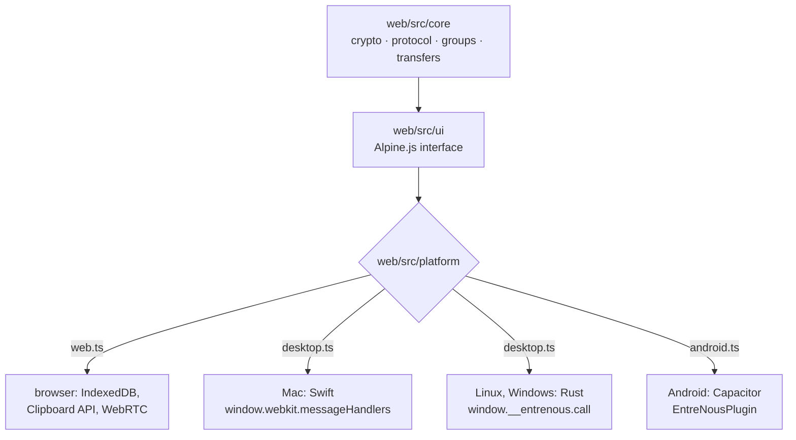

# Development
[Français](../developpement.md)

Design choices and their history are in [BRAINSTORM.md](../../BRAINSTORM.md) (in French).

## Layout

| Folder | Contents |
|---|---|
| `web/` | TypeScript core (`src/core/`: crypto, protocol, groups, transfers, local mode), Alpine.js interface as a CSP build (`src/ui/`), bridges to the apps (`src/platform/`), home page |
| `relay/` | Node + Redis relay (in RAM); also serves the home page, the web app and the downloads |
| `macos/` | menu bar app (Swift + WKWebView) |
| `desktop/` | Linux and Windows app (Rust + Tauri, WebKitGTK / WebView2) |
| `android/` | Android app (Capacitor 8), native plugin `EntreNousPlugin.java` |
| `downloads/` | apps built locally (not versioned) |
| `scripts/auto-update.sh` | automatic update of a relay to the latest release |
| `Dockerfile`, `docker-compose.yml` | the relay in a single container |

Every app ships the same interface (`web/dist/app`) and talks to the same core; each one only adds
a native bridge (key storage, clipboard, files):



The core doesn't depend on the DOM: it also runs in Node, for the tests.

## Web app and relay

```sh
docker compose up -d --build     # relay on http://127.0.0.1:8080 (home page, /app/)
cd web
npm install
npm run build                    # dist/: home page (/) and web app (/app/)
npm run dev                      # continuous build
npm run typecheck
npm test                         # the relay must be running (RELAY=https://… for another one)
npm run test:ui                  # interface, in Chrome (HEADED=1 to watch it)
```

The tests run real devices (engines) against the relay: pairing, sending, resuming after a
connection drop, deleting during an upload, removing a device, local mode (with an in-memory
link in place of WebRTC, which Node doesn't have).

The documentation images (`docs/images/`) are regenerated with `npm run screenshots` (relay
running, Chrome and ffmpeg): three demo devices in Chrome, one of them a Mac with a simulated
native bridge; screenshots, staged scenes and animation. It also regenerates the ones on the
relay's home page (`web/public/images/`: the three devices in light and dark, the animation as
WebP). It runs in French, then in English: the English images end in `-en`
(`node scripts/screenshots.mjs en` for one language only). The SVG diagrams (`chiffrement.svg`,
`reseau.svg` and their `-en.svg` versions) are written by hand; the home page reuses them,
copied at build time (`build.mjs`).

### Languages

The interface comes in French and English: the language of the system or the browser (English
for any other language), or the one chosen in Settings → Language. The texts live in
`web/src/i18n/fr.ts` and `en.ts` (same keys, checked by `npm run typecheck`); the HTML shows them
with `x-text="t('key')"`, and `x-rich` for a little formatting (`**bold**`, line break). The
desktop apps get the interface's language (`setLang`) for their icon's menu.

The home page comes as two files, `web/public/index.html` (French) and
`web/public/en/index.html`: `/` serves one or the other according to `Accept-Language`, `/fr/`
and `/en/` serve them directly. The English documentation lives in `docs/en/` and `README.en.md`.

The interface tests (`test/ui/`) open the app served by the relay in several Chrome profiles (one
per device, including a simulated Android phone): note, confirmations, upload in progress and
downloads, invitations, removal. They use the installed Chrome (`playwright-core`, no browser
downloaded); the relay must have been rebuilt with the app under test.

## Mac app

```sh
cd macos
./build-app.sh                                 # → build/Entre Nous.app
UNIVERSAL=1 ./build-app.sh                     # Apple silicon + Intel, plus downloads/Entre-Nous-mac.zip
RELAY=http://127.0.0.1:8080 ./build-app.sh     # local relay
open "build/Entre Nous.app"
```

- Tools: Swift (Xcode or the Command Line Tools), macOS 14 or later.
- Keys in the Keychain, as a single entry (`dev.0xdba.entrenous` / `store`).
- Signing: `./signing-identity.sh` (once per Mac) creates a local "Entre Nous" certificate;
  without it, the signature is ad hoc and every rebuild asks for Keychain access again.
- Relay: `defaults write dev.0xdba.entrenous relay <url>`.

## Linux and Windows app

```sh
desktop/build.sh                     # Linux (.deb, .AppImage) and Windows (.exe installer)
TARGETS=linux desktop/build.sh       # just one of the two
ENTRENOUS_RELAY=https://… desktop/build.sh
```

- Built in Docker (`desktop/docker` image, Ubuntu 22.04 for an old enough glibc): nothing to
  install on your machine. Windows is cross-compiled with
  [cargo-xwin](https://github.com/rust-cross/cargo-xwin), which downloads Microsoft's CRT and SDK
  once (their license applies), and packaged with NSIS.
- The image is `linux/amd64`: emulated on an Apple silicon Mac, the first build takes a while.
- Without Docker, on the target machine: the [Tauri prerequisites](https://v2.tauri.app/start/prerequisites/),
  then `cargo install tauri-cli` and `cd desktop/src-tauri && cargo tauri build`.
- Native bridge (`desktop/src-tauri/src/`): `store.rs` (encrypted file, key in the system
  keyring), `clip.rs` (clipboard watching), `files.rs` (received files), `main.rs` (window, icon,
  calls from the interface). Same calls as the Mac app (`web/src/platform/desktop.ts`).
- Closing the window keeps the app running in the system tray; **Quit** is in the icon's menu.
  `--hidden` starts it straight in the system tray.
- Linux: X11 clipboard (on Wayland, through XWayland). On GNOME, the icon needs the AppIndicator
  extension; without it, launching the app again brings its window back.
- The GitHub CI (`.github/workflows/apps.yml`) builds the four apps (Linux, Windows, Android, Mac)
  on every push to `master`, unless only the documentation changed, then publishes them as the
  latest GitHub release (the only one kept). See [Versions and releases](#versions-and-releases).

## Android app

```sh
android/build.sh          # signed APK → downloads/Entre-Nous-android.apk (Docker)
```

- Built in Docker (JDK 21 + Android SDK), as `linux/amd64`.
- Signing key kept outside the repository, in `~/.config/entrenous/` (created on the first build):
  **back it up**, since an update must be signed with the same key. Never commit it.
- Its fingerprint is published in `web/public/.well-known/assetlinks.json` (generated), so that
  invitation links open the app.
- Relay set in `web/src/platform/android.ts`.

## Versions and releases

- Build version: `0.1.<number of commits>` (`git rev-list --count HEAD`), the same for every app
  built from a given commit; `APP_VERSION` overrides it. It's written into the interface
  (`__VERSION__`, `web/build.mjs`), the Mac app, the APK (`versionCode` = number of commits) and
  the Tauri apps.
- The CI publishes the `v0.1.N` release with fixed file names (`Entre-Nous-mac.zip`,
  `Entre-Nous-android.apk`, `Entre-Nous-windows.exe`, `Entre-Nous-linux.deb`,
  `Entre-Nous-linux.AppImage`) and deletes the previous ones.
- The APK is signed using the `ANDROID_KEYSTORE` (the `.jks` in base64) and
  `ANDROID_KEYSTORE_PASSWORD` secrets; without them, the release isn't published. The Mac app has
  an ad hoc signature.
- Relays announce the latest release to the apps (the `latest` field in the `hello` response);
  an older app shows "New version available".

## Code rules

- The core (`web/src/core/`) never touches the DOM.
- Interface in Alpine.js **CSP build**: no `eval`, so no arrow functions or template literals in
  HTML attributes; use methods instead.
- Protocol: requests `{ rid, op, … }`, responses `{ rid, ok, … }`, events `{ ev, … }`;
  `rid` is never a business field.
- The relay never logs content or room identifiers.
- Docker base images without a pinned version (`node:lts-alpine`, `ubuntu:jammy`…).
- Interface text in natural French and English, free of technical jargon; every new text goes
  into both dictionaries (`web/src/i18n/`).
- Never name a loop variable (`x-for`) `t`: it would hide the `t()` method.
