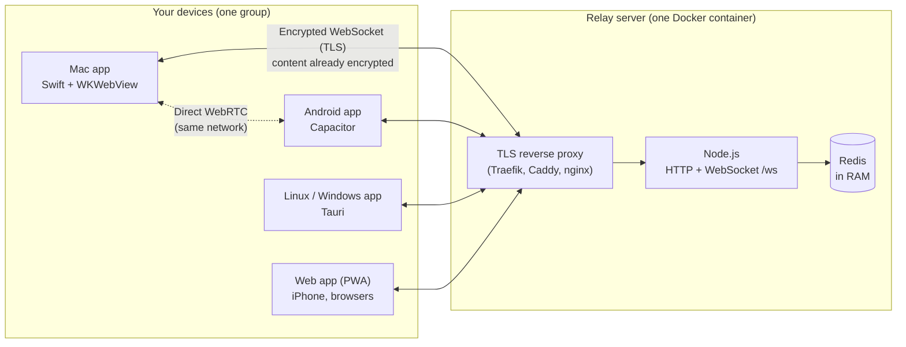
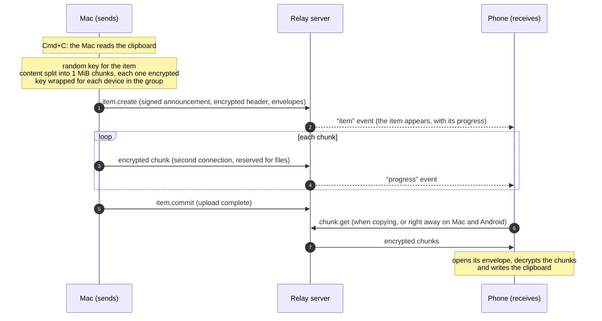
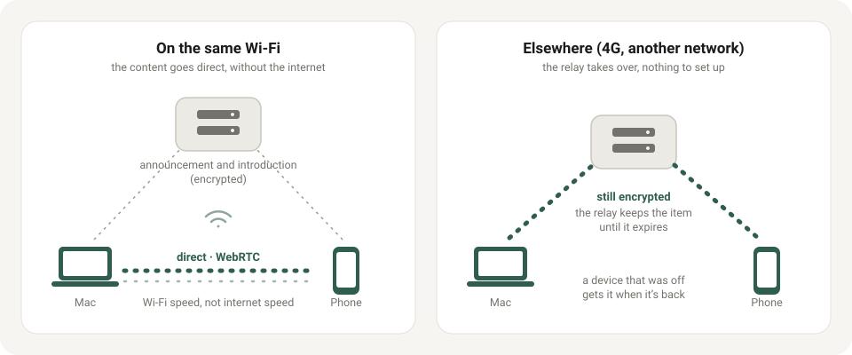
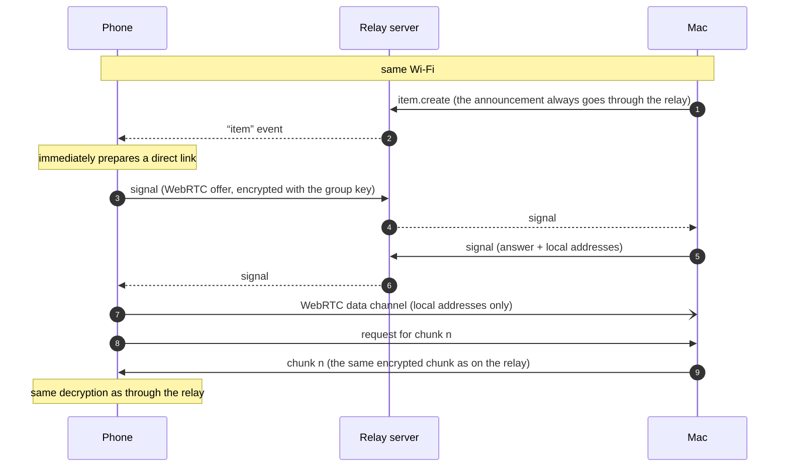
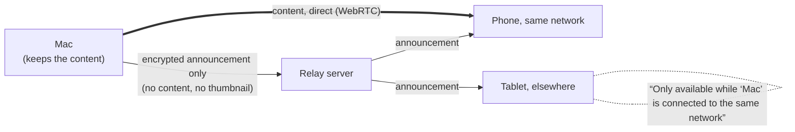
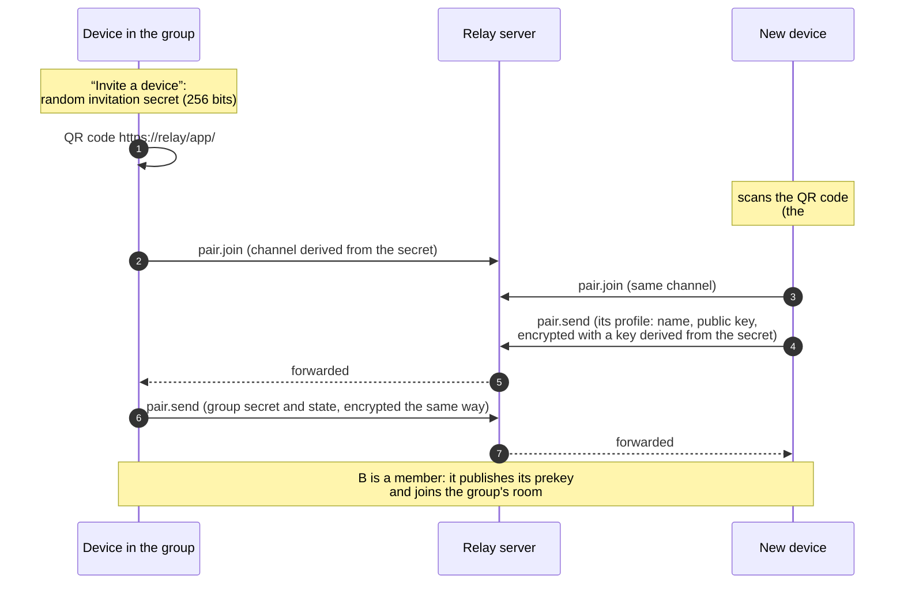
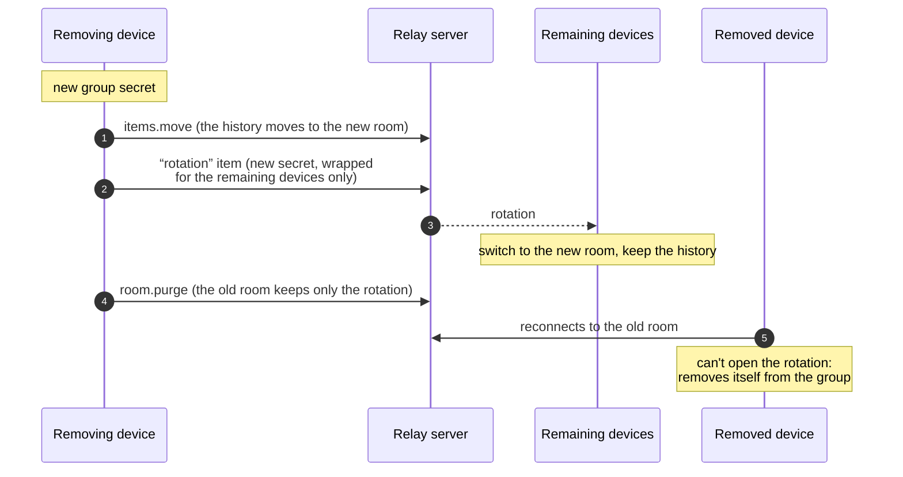

# How it works
[Français](../fonctionnement.md)

Entre Nous connects one person's devices: what you copy on one, you paste on another. Everything
is encrypted on the sending device and decrypted on the receiving one; in between, a **relay
server** passes along data it can't read, or the devices exchange the content **directly** when
they're on the same network.

- [The building blocks](#the-building-blocks)
- [Sending through the relay server](#sending-through-the-relay-server)
- [Local mode: direct on the same network](#local-mode-direct-on-the-same-network)
- [Pairing a device](#pairing-a-device)
- [Removing a device](#removing-a-device)
- [History, expiry, note](#history-expiry-note)
- [Relay protocol](#relay-protocol)

Security (algorithms, keys, what the server sees) is covered in detail in [security.md](security.md).

## The building blocks

- **A single core** (`web/src/core/`, TypeScript, no DOM): cryptography, protocol, groups,
  transfers. It runs in the browser, in the apps (which ship the same interface) and in Node
  for the tests.
- **The native apps** add what a browser can't do:

  | | Key storage | Clipboard | Extras |
  |---|---|---|---|
  | Mac | Keychain (a single entry) | watched, written without a tap | menu bar icon, drag and drop onto the icon, notifications |
  | Linux, Windows | encrypted file, key in the system keyring | watched, written without a tap | system tray icon, notifications |
  | Android | encrypted with a Keystore key | written without a tap | "Share → Entre Nous", invitation links |
  | Web app | the browser's IndexedDB | "Send clipboard" button, Ctrl+V | nothing to install |

- **The relay** is deliberately simple: it stores encrypted chunks in memory, notifies the
  connected devices, and deletes everything when it expires. It also serves the home page, the
  web app and the downloadable apps.

## Sending through the relay server

This is the default path: it works everywhere (4G, hotel Wi-Fi, corporate network), without
opening any port on your router, and the receiving device can be off when you send.

- **An item** = an announcement signed by the sender, an encrypted header (type, name, size,
  short text, and the preview: thumbnail, size in pixels, the length of a video or an audio file, the start of a text),
  one envelope per device, and the content's chunks.
- **Previews**: the chunks can be read in any order. So a video or an audio file plays while it arrives: the
  device decrypts only the chunks the player needs (an MP4's index, often at the end, then the
  rest), keeps a few in memory and fetches the next ones ahead; jumping ahead goes straight
  to the right chunk (for an MP3, from its table of contents or its bitrate; for Opus or FLAC, from the position written
  in the file). A text reads only its first one.
- **During the upload**, the item is already visible everywhere, and the upload's progress shows
  above the history; a device can start downloading before the end, following the upload as it
  goes (its progress shows in the item). Copying, however, waits for the upload to finish.
- **Connection drop** (sleep, network): the upload resumes with the missing chunks as soon as the
  connection is back, as long as the app stays open and the item hasn't expired.
- **Offline device**: the item waits for it on the relay until it expires (24 h by default); the
  device sees it when the app is opened. Automatic clipboard sharing, on the other hand, waits
  for another device to be connected and then sends the latest copy.

## Local mode: direct on the same network

When two devices in the group are on the same network, content goes **straight from one to the
other** over WebRTC, without going through the internet. It's transparent: nothing to set up.

- **No STUN or TURN server**: only local network addresses are exchanged, so the link can only
  be made locally, never through a third party or across the internet.
- **The relay acts as a switchboard**: it passes along the connection setup messages (encrypted,
  never stored) and keeps the history and the group's state. It's still needed in local mode,
  at least for the announcements.
- **What goes over the link**: exactly the same encrypted chunks as on the relay, served by the
  device that sent the item (it keeps them in memory as long as it's open).
- **If the link fails** (different network, guest Wi-Fi that isolates devices, firewall), the
  relay silently takes over. A download starts through the relay and switches to direct as soon
  as the link is ready.
- **Throughput**: up to 20–30 MB/s between two computers, 7–10 MB/s from a phone on Wi-Fi to a
  Mac (measured in November 2026), versus your router's upload speed through the relay.

### Local network only

A group setting so that **nothing leaves the local network**, text included:

- The relay receives **no chunk** of the content: only the encrypted announcement.
- An item is only available while its sender is open on the same network; elsewhere, it's shown
  as unavailable, with no buttons.
- Once the setting is turned off, the sender can hand a local item over to the server, manually,
  with "Send to server". It's never automatic: some content must never leave the network.

## Pairing a device

- An invitation is valid for **3 minutes, for a single device**. Any member can invite.
- No account: a group is nothing more than a secret shared by its devices. A device can belong
  to several independent groups.
- On iPhone, an invitation opened in Safari first offers to add the web app to the Home Screen
  (its storage is separate from Safari's, so you then scan from the app), or to go on in Safari
  without installing it.

## Removing a device

- The remaining devices **keep the history**; the removed device can no longer read anything sent
  afterwards, nor the history (moved out of its reach).
- A group reduced to a single device is dissolved.
- A device that was off during a rotation doesn't receive the new secret: it has to be paired
  again.

## History, expiry, note

- **Shared history**: each item stays available on every device until it expires; any device
  can copy it, save it, or delete it for everyone.
- **Group settings** (any member can change them): retention time (10 min, 1 h, 24 h by
  default, 7 days, capped by the server), history size (1, 10 or unlimited), maximum size for
  automatic sharing, local network only.
- **Expiry**: the relay deletes an item at the set time, and it disappears from the local
  history at that very second. Files received by the desktop apps are deleted at the same moment.
- **Live note**: a text field synced as you type, encrypted like everything else. "Send" turns
  it into a history item, leaving the note in place.

## Relay protocol

WebSocket on `/ws`. JSON requests `{ rid, op, … }`, responses `{ rid, ok, … }`, events
`{ ev, … }`; chunks travel as binary frames. A device opens one connection for messages and a
second one, reserved for chunks, so that a large upload never holds up anything else.

| Operations | Purpose |
|---|---|
| `hello` | joins a room (opaque identifier derived from the group secret) |
| `state.put`, `prekey.put` | group state (encrypted, versioned), devices' public prekeys |
| `item.create`, `chunk.put`, `chunk.have`, `item.commit`, `chunk.get` | sending and reading an item |
| `item.delete`, `items.clear`, `items.trim`, `items.shorten` | deletion, history size, shortened retention |
| `note.put` | live note (latest version only) |
| `item.publish` | a local item sent to the server |
| `signal` | WebRTC connection setup (forwarded, never stored) |
| `items.move`, `room.purge`, `room.delete` | removing a device, dissolving a group |
| `pair.join`, `pair.send`, `pair.leave` | temporary pairing channel |

Events: `item`, `progress`, `presence`, `state`, `prekey`, `note`, `deleted`, `refresh`,
`gone`, `signal`, `pair`, `pair.peer`.

Limits: 200 requests/s per connection, 32 connections per IP address, 1 MiB chunks.
The relay never logs content or room identifiers.
