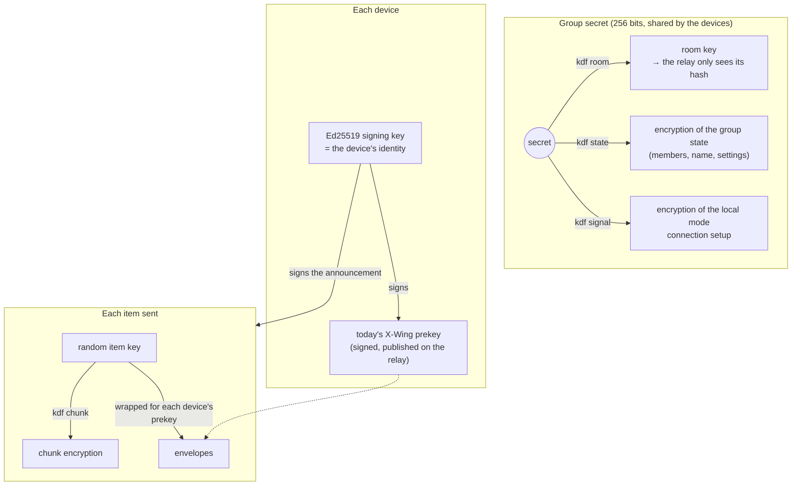

# Security
[Français](../securite.md)

The starting point: **the relay server must not be able to read anything**. Everything is
encrypted on the sending device and can only be decrypted on the group's devices; the relay
carries and stores opaque data, in memory, until it expires.

- [What the server sees, and what it doesn't](#what-the-server-sees-and-what-it-doesnt)
- [Algorithms](#algorithms)
- [The keys](#the-keys)
- [Encrypting an item](#encrypting-an-item)
- [Storage on the devices](#storage-on-the-devices)
- [The relay](#the-relay)
- [Known limitations and threats](#known-limitations-and-threats)
- [Reporting a vulnerability](#reporting-a-vulnerability)

## What the server sees, and what it doesn't

| The relay never sees | The relay sees |
|---|---|
| the content: text, images, files, note | the IP addresses of connected devices |
| file names, types, previews (thumbnails, lengths, starts of texts) | when things are sent, and how many |
| the group's name, the devices' names and types | an approximate size (rounded to 64 KiB, 256 B for the header) |
| the group secret, the private keys | an opaque room identifier, pseudonymous device identifiers |
| the local addresses exchanged for local mode | who is connected right now (to show it to the other devices) |
| what read receipts say (delivered or read, and when) | when a device sends a read receipt, and for which item |
| which items are pinned | that an item was pinned or unpinned, without knowing which |

The relay never logs content or room identifiers, and keeps nothing on disk (except with the
`PERSIST` option, which only stores the same encrypted data).

## Algorithms

The [`@noble`](https://paulmillr.com/noble/) libraries (pure JavaScript, audited), with the same
code on every platform.

| Use | Choice |
|---|---|
| Key exchange | hybrid X25519 + ML-KEM-768 (X-Wing combiner): resistant to a future quantum computer |
| Signatures | Ed25519 |
| Encryption | XChaCha20-Poly1305 (192-bit nonces) |
| Key derivation | HKDF-SHA-256, each use labeled `entrenous/v1/<usage>` |
| Transport | TLS to the relay; DTLS for local mode (WebRTC); on top of end-to-end encryption |

## The keys

- **The group** is nothing more than a 256-bit secret, passed along during pairing over a channel
  encrypted with a single-use invitation secret (the QR code). It never leaves the devices.
- **Each device** has its own signing key (its identity) and publishes, for each group, a signed
  X-Wing prekey that is **rotated every day**. An old prekey is destroyed once it has been
  replaced and the group's retention time has passed: stealing the device doesn't let anyone read
  back what has already expired (forward secrecy, to within a day).
- **Pairing** goes through a `https://relay/app/#p=<secret>` link: the fragment after `#` is never
  sent to the server, and the page wipes it immediately. The invitation is valid for 3 minutes,
  for a single device.
- **Removing a device** replaces the group secret; the new secret is wrapped only for the
  remaining devices, and the history is moved to a room the removed device doesn't know about.

## Encrypting an item

- The content is encrypted **only once**; only the key is wrapped for each device (a construction
  close to HPKE).
- Each chunk is authenticated with its index, the item's identifier and a "last" flag: a
  malicious relay can't reorder, truncate, or mix up the chunks of two items.
- The announcement is signed by the sending device; the others verify the signature against the
  key of a known group member.
- **Local mode**: the very same sealed chunks travel over the direct link. Connection setup
  messages (local addresses included) are encrypted with the group key and bound to the sender
  and the recipient.

## Share links

A share link gives someone outside the group access to a single item, in a browser.

- The link is `https://<relay>/s/#<secret>`: a random 256-bit secret, after the `#`. A browser
  never sends that part to the server.
- The relay only knows the link's identifier, `sha256(HKDF(secret, "share/id"))`, and the item's
  key sealed (XChaCha20-Poly1305) with `HKDF(secret, "share/key")`. It keeps the item's encrypted
  header and chunks, without being able to read them.
- The link's page decrypts the header and the chunks in the browser, with the same checks as in
  the group (chunks can be neither reordered nor truncated). It gets neither the group secret, nor
  the other items, nor the devices' names.
- Only the device that created the link can change its lifetime or delete it: it keeps a second
  secret for that, of which the relay only knows the SHA-256 hash.
- The relay keeps an item's chunks as long as the item or one of its links exists, at most
  `MAX_TTL` (7 days) after the link was last changed.
- Anyone who has the link can open the item. The relay also sees when a link is opened, and from
  which IP address.

## File requests

A file request lets someone outside the group send files to the group.

- The link is `https://<relay>/r/#<secret>`: a random 256-bit secret, after the `#`, never sent to
  the server.
- Each request has its own X-Wing key pair. The private key only exists in the group's encrypted
  state, on its devices. The relay keeps the request's identifier, `sha256(HKDF(secret, "drop/id"))`,
  and the public key with the message, sealed with `HKDF(secret, "drop/info")`: it can neither read
  them nor replace the public key.
- The page encrypts each file with a random key, sealed for the request's public key. The link lets
  people send, never read: neither the relay nor anyone with the link can open what was sent, nor
  see the group's history.
- What arrives is not signed: the group only knows the sender had the link. The first name is the
  one the person typed. Only files and folders are accepted, shown and never run, like the rest.
- Anyone who has the link can send files to the group until it ends, within the server's space. The
  relay sees the approximate size of each upload, and the sender's IP address.
- A device removed from the group still knows the requests open at that time: it can send files
  through them, but can no longer read anything (the history moved to another room).

## Storage on the devices

| Platform | Where the keys live |
|---|---|
| Mac | login Keychain (a single entry), readable by this app only |
| Android | encrypted with an AES-GCM key from the Android Keystore, never extractable; cloud backup disabled |
| Windows | encrypted file (XChaCha20-Poly1305) in `%APPDATA%`, key in Credential Manager |
| Linux | encrypted file in `~/.local/share`, key in the Secret Service (GNOME Keyring, KWallet); failing that, in a file readable by the user only (weaker) |
| Web app | the browser's IndexedDB, protected by the user's session |
| Command line | plain files in `~/.local/share/entrenous` (`%LOCALAPPDATA%` on Windows), readable by the user only, like SSH keys (weaker than the apps); no content is ever written there |

- What the desktop apps write to the clipboard is marked as "secret" (`ConcealedType` on Mac,
  exclusion formats on Windows, KDE hint on Linux): clipboard history tools ignore it. Conversely,
  anything password managers mark this way is never shared.
- Files received by the desktop apps are stored in the user's temporary folder and deleted when
  the item expires. A file opened in another app (**Open**, in the desktop and Android apps) is also
  deleted when Entre Nous quits.
- Notifications only show the type and the sender ("Text from Pixel"), never the content.

## The relay

- A single Node + Redis container, **in memory**; restarting the container wipes everything.
- Read-only container, without privileges (`cap_drop: ALL`, `no-new-privileges`), non-root user,
  limited number of processes.
- Redis: random password at each start, reachable only from inside the container.
- Strict headers on the pages it serves: CSP with no inline script and no `eval` (Alpine.js CSP
  build), `frame-ancestors 'none'`, HSTS, `no-referrer`.
- Limits: 200 requests/s per connection, 32 connections per IP address, storage quota.

## Known limitations and threats

- **Web app**: its code is served by the relay. A compromised relay could serve malicious code to
  the web app, which would then see what you do in it (a limitation of any web app). The Mac,
  Android, Linux and Windows apps ship their own interface: their code never comes from the server.
- **Share link page**: served by the relay, like the web app. A compromised relay could change it
  to read the shared item.
- **File request page**: served by the relay too. A compromised relay could change it to read what
  the person sends.
- **Availability**: the relay can refuse, delay or delete items. It can't forge or read them.
- **Metadata**: see the table above (IP addresses, times, approximate sizes, presence).
- **Compromised device**: a device in the group can read everything the group shares for as long as
  it's a member. Removing it from another device cuts off its access to what comes next and to the
  history.
- **Signatures**: Ed25519 isn't post-quantum. This only matters for an active attack carried out
  at the very moment of sending; the content itself is protected by X-Wing.
- **Apps not signed by a recognized developer**: Mac app not notarized, APK installed outside the
  Play Store, unsigned Windows app (SmartScreen warning). Make sure you download them from your
  relay or from the releases published on GitHub.
- **Previews**: what another device of the group sends is shown, never run. The HTML in a Markdown
  file is written as text, its images are not loaded (they would tell their server who reads the
  file), only `https:`, `http:` and `mailto:` links stay; images, videos and sounds are decoded by
  the browser or the system's web view, as on a web page. A thumbnail is re-encoded by the sender: it
  keeps none of the photo's metadata. PDFs are read by pdf.js in a worker, without their scripts,
  XFA forms or WebAssembly; only their `https:`, `http:` and `mailto:` links open, outside.
- **No independent audit** so far. The code is public: anyone can review it.

## Reporting a vulnerability

Please don't open a public issue: use **"Report a vulnerability"** in the *Security* tab of the
GitHub repository (private report). See [SECURITY.md](../../SECURITY.md).
