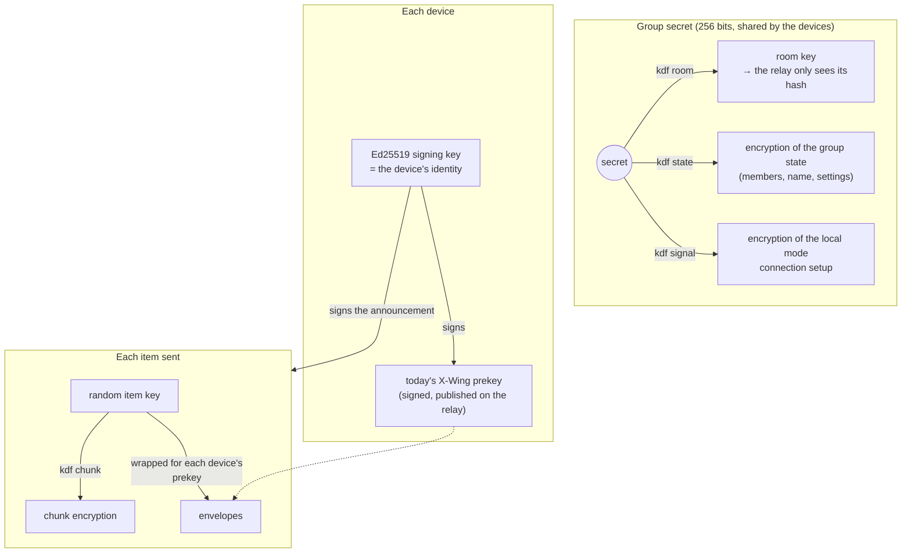
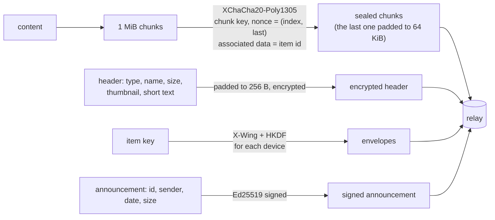

# Security
[Français](../securite.md)

The starting point: **the relay server must not be able to read anything**. Everything is
encrypted on the sending device and can only be decrypted on the group's devices; the relay
carries and stores opaque data, in memory, until it expires.

- [What the server sees, and what it doesn't](#what-the-server-sees-and-what-it-doesnt)
- [Algorithms](#algorithms)
- [The keys](#the-keys)
- [Encrypting an item](#encrypting-an-item)
- [Storage on the devices](#storage-on-the-devices)
- [The relay](#the-relay)
- [Known limitations and threats](#known-limitations-and-threats)
- [Reporting a vulnerability](#reporting-a-vulnerability)

## What the server sees, and what it doesn't

| The relay never sees | The relay sees |
|---|---|
| the content: text, images, files, note | the IP addresses of connected devices |
| file names, thumbnails, types | when things are sent, and how many |
| the group's name, the devices' names and types | an approximate size (rounded to 64 KiB, 256 B for the header) |
| the group secret, the private keys | an opaque room identifier, pseudonymous device identifiers |
| the local addresses exchanged for local mode | who is connected right now (for automatic sharing) |

The relay never logs content or room identifiers, and keeps nothing on disk (except with the
`PERSIST` option, which only stores the same encrypted data).

## Algorithms

The [`@noble`](https://paulmillr.com/noble/) libraries (pure JavaScript, audited), with the same
code on every platform.

| Use | Choice |
|---|---|
| Key exchange | hybrid X25519 + ML-KEM-768 (X-Wing combiner): resistant to a future quantum computer |
| Signatures | Ed25519 |
| Encryption | XChaCha20-Poly1305 (192-bit nonces) |
| Key derivation | HKDF-SHA-256, each use labeled `entrenous/v1/<usage>` |
| Transport | TLS to the relay; DTLS for local mode (WebRTC); on top of end-to-end encryption |

## The keys

- **The group** is nothing more than a 256-bit secret, passed along during pairing over a channel
  encrypted with a single-use invitation secret (the QR code). It never leaves the devices.
- **Each device** has its own signing key (its identity) and publishes, for each group, a signed
  X-Wing prekey that is **rotated every day**. An old prekey is destroyed once it has been
  replaced and the group's retention time has passed: stealing the device doesn't let anyone read
  back what has already expired (forward secrecy, to within a day).
- **Pairing** goes through a `https://relay/app/#p=<secret>` link: the fragment after `#` is never
  sent to the server, and the page wipes it immediately. The invitation is valid for 3 minutes,
  for a single device.
- **Removing a device** replaces the group secret; the new secret is wrapped only for the
  remaining devices, and the history is moved to a room the removed device doesn't know about.

## Encrypting an item

- The content is encrypted **only once**; only the key is wrapped for each device (a construction
  close to HPKE).
- Each chunk is authenticated with its index, the item's identifier and a "last" flag: a
  malicious relay can't reorder, truncate, or mix up the chunks of two items.
- The announcement is signed by the sending device; the others verify the signature against the
  key of a known group member.
- **Local mode**: the very same sealed chunks travel over the direct link. Connection setup
  messages (local addresses included) are encrypted with the group key and bound to the sender
  and the recipient.

## Storage on the devices

| Platform | Where the keys live |
|---|---|
| Mac | login Keychain (a single entry), readable by this app only |
| Android | encrypted with an AES-GCM key from the Android Keystore, never extractable; cloud backup disabled |
| Windows | encrypted file (XChaCha20-Poly1305) in `%APPDATA%`, key in Credential Manager |
| Linux | encrypted file in `~/.local/share`, key in the Secret Service (GNOME Keyring, KWallet); failing that, in a file readable by the user only (weaker) |
| Web app | the browser's IndexedDB, protected by the user's session |
| Command line | plain files in `~/.local/share/entrenous` (`%LOCALAPPDATA%` on Windows), readable by the user only, like SSH keys (weaker than the apps); no content is ever written there |

- What the desktop apps write to the clipboard is marked as "secret" (`ConcealedType` on Mac,
  exclusion formats on Windows, KDE hint on Linux): clipboard history tools ignore it. Conversely,
  anything password managers mark this way is never shared.
- Files received by the desktop apps are stored in the user's temporary folder and deleted when
  the item expires.
- Notifications only show the type and the sender ("Text from Pixel"), never the content.

## The relay

- A single Node + Redis container, **in memory**; restarting the container wipes everything.
- Read-only container, without privileges (`cap_drop: ALL`, `no-new-privileges`), non-root user,
  limited number of processes.
- Redis: random password at each start, reachable only from inside the container.
- Strict headers on the pages it serves: CSP with no inline script and no `eval` (Alpine.js CSP
  build), `frame-ancestors 'none'`, HSTS, `no-referrer`.
- Limits: 200 requests/s per connection, 32 connections per IP address, storage quota.

## Known limitations and threats

- **Web app**: its code is served by the relay. A compromised relay could serve malicious code to
  the web app, which would then see what you do in it (a limitation of any web app). The Mac,
  Android, Linux and Windows apps ship their own interface: their code never comes from the server.
- **Availability**: the relay can refuse, delay or delete items. It can't forge or read them.
- **Metadata**: see the table above (IP addresses, times, approximate sizes, presence).
- **Compromised device**: a device in the group can read everything the group shares for as long as
  it's a member. Removing it from another device cuts off its access to what comes next and to the
  history.
- **Signatures**: Ed25519 isn't post-quantum. This only matters for an active attack carried out
  at the very moment of sending; the content itself is protected by X-Wing.
- **Apps not signed by a recognized developer**: Mac app not notarized, APK installed outside the
  Play Store, unsigned Windows app (SmartScreen warning). Make sure you download them from your
  relay or from the releases published on GitHub.
- **No independent audit** so far. The code is public: anyone can review it.

## Reporting a vulnerability

Please don't open a public issue: use **"Report a vulnerability"** in the *Security* tab of the
GitHub repository (private report). See [SECURITY.md](../../SECURITY.md).
