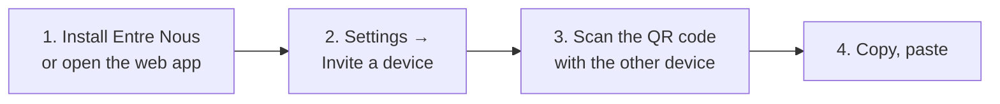
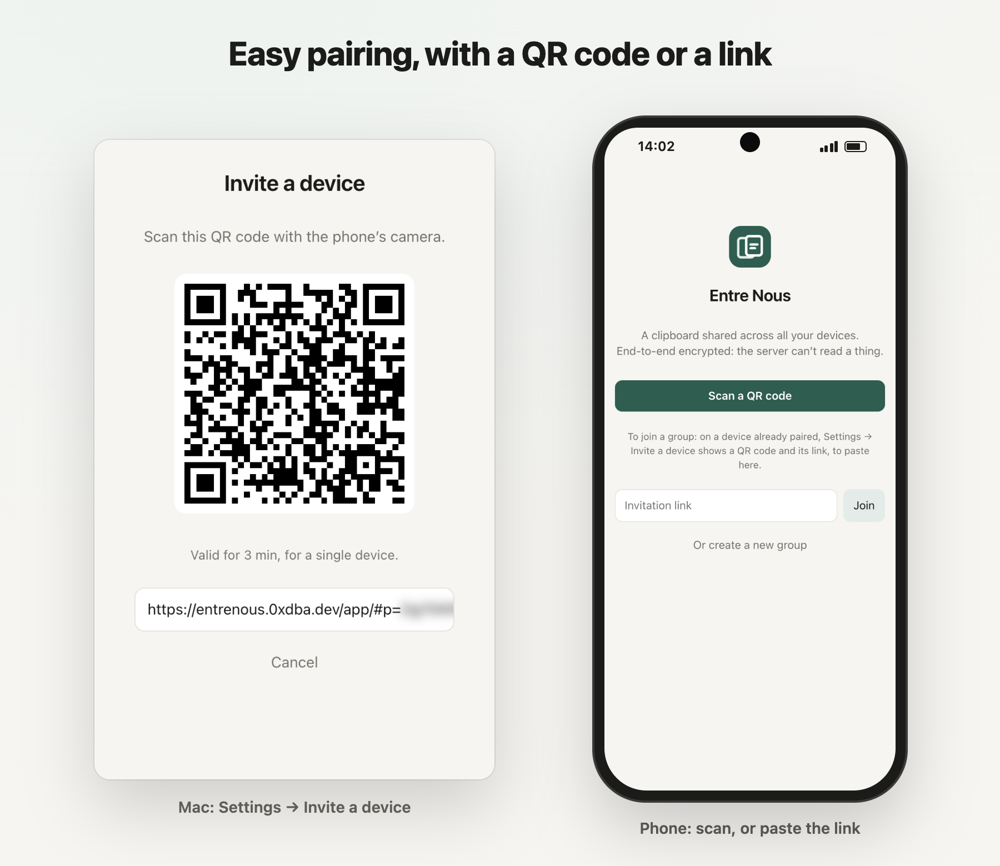
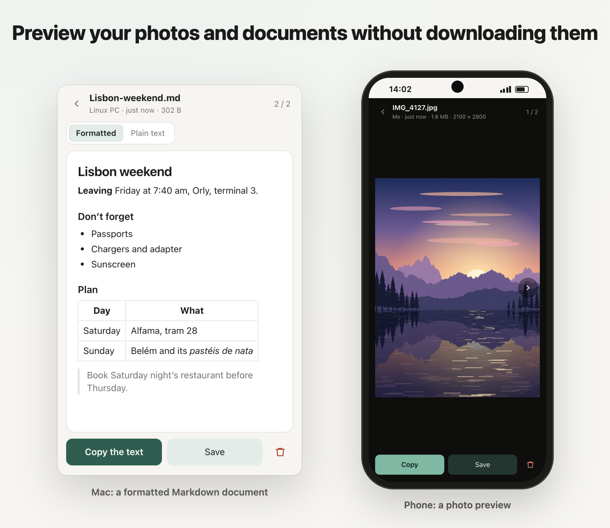
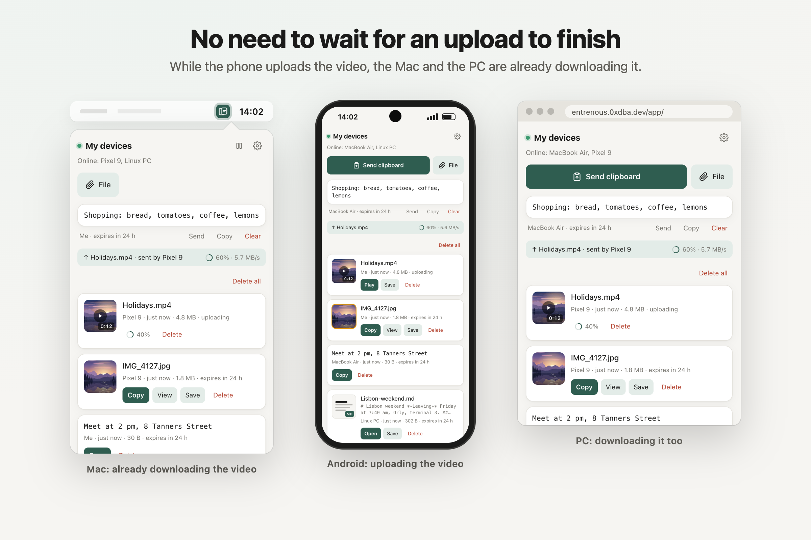
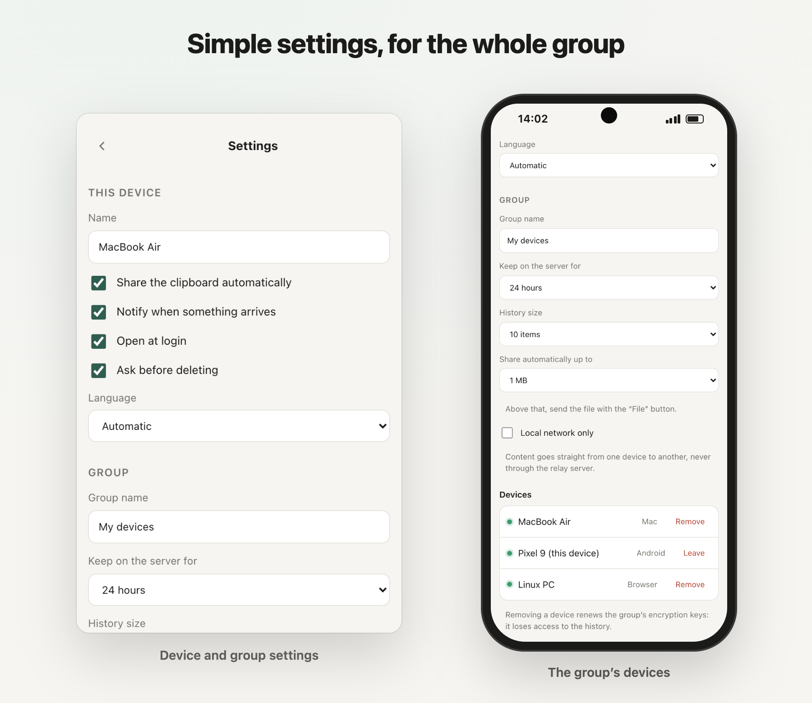

# Using Entre Nous
[Français](../utilisation.md)

Copy on one device, paste on another. No account: your devices form a **group**, paired by
QR code.

## 1. Install

| Device | How |
|---|---|
| Mac | download the zip from the home page and drag **Entre Nous** into Applications; the app lives in the menu bar |
| Android | download the APK and open it (Android asks you to allow the install) |
| Linux | `.deb` package (Debian, Ubuntu…) or `.AppImage` (any distribution); icon in the system tray |
| Windows | `.exe` installer; icon in the system tray |
| iPhone, iPad | open the web app in Safari, then **Share → Add to Home Screen**, and launch it from that icon |
| Other | the web app, in any recent browser |
| Terminal | `entrenous`, on the command line (Node.js 22): see [Entre Nous on the command line](cli.md) |

On first launch, a computer creates a "My devices" group on its own.

## 2. Pair your devices

1. On a device that's already paired: **Settings → Invite a device**. A QR code appears
   (valid for 3 minutes, for a single device).
2. On the new device: scan it with the camera (or **Scan a QR code** in the app), or paste the
   invitation link shown under the QR code into **Join** (on the home screen, or in Settings).
   Handy on a computer without a camera, or to send the link remotely through a messaging app.
3. Done: both devices show up in **Settings → Devices**.

You can create more groups (one for family, one for work): they're independent of each other.

## 3. Send

| | How to send |
|---|---|
| Mac, Linux, Windows | **just copy**: whatever you copy is sent on its own as soon as another device is connected, and so is a file copied in the file manager. **File** button, or drag a file onto the window (on a Mac, onto the menu bar icon) |
| Android | **Send clipboard**, **File**, or **Share → Entre Nous** from any app |
| iPhone | **Send clipboard** (tap "Paste" in the bubble), **File** |
| Browser | Ctrl+V in the page, drag and drop, **File** |

- **Note**: the text field at the top syncs to every device as you type. **Send** adds it to the
  history and leaves the note in place.
- **Pause** (computers): the ⏸ button or **Pause sharing** in the icon's menu. While paused,
  nothing is read or sent on its own, and anything you copy in the meantime is never sent. To
  send what you just copied anyway: **Send clipboard** (or Cmd/Ctrl+V in the window), just as
  when **Share the clipboard automatically** is turned off in Settings (the ⏸ button then
  disappears).
- **Automatic sharing limit** (a group setting, 1 MB by default): anything larger isn't sent
  on its own; use **File**. Manual sends have no limit.

## 4. Receive

- **Mac, Linux, Windows, Android**: whatever arrives goes straight into the clipboard. Just
  paste. A file received on a computer can also be pasted in the file manager.
- **iPhone**: tap **Copy** on the item (iOS doesn't allow writing to the clipboard without a
  user gesture).
- **History**: everything that was shared stays available on every device until it expires:
  **Copy**, **Save**, **Share**, or **Delete** (for everyone: the confirmation reads
  **Delete everywhere**). **Delete all** clears the history and the note.
- **Upload in progress**: an "↑ name" line above the history shows its progress and speed on
  every device, and disappears when it's done. The item appears right away: you can **Save** it
  before the upload finishes (the download follows the upload), while **Copy** becomes available
  once the upload is complete (the apps then copy it on their own). If nothing is heard from the
  sender for 5 minutes, the item is marked "upload interrupted".
- **Download**: its progress shows in the item, in place of the buttons.

### Previews

A photo, a video, an audio file, a PDF, a text or a Markdown file opens in the app, without saving
it: tap the thumbnail, or **View** (image), **Play** (video), **Listen** (audio), **Open** (PDF,
text, Markdown). The arrows (or a
swipe on a phone, ← → on a keyboard) go from one item to the next; Escape closes.

- **In the history, before any download**: a photo's thumbnail, a video's poster and length, an
  audio file's length, a PDF's first page and number of pages, the first words of a text. The sending device makes them and attaches them, encrypted, to the item;
  the server sees none of it. A thumbnail keeps none of the photo's metadata (place, camera); the
  file itself is sent as it is. In "Local network only" mode none of this goes through the
  server: the item shows without a preview.
- **Video**: it plays while it arrives, without being downloaded whole, and you can jump forward
  or back at any time (even while the other device is still sending it). MP4 and MOV (what phones
  record); other formats, or an iPhone older than iOS 17.1, download it first. A format the device
  cannot play (HEVC on some PCs, for instance) offers **Save**.
- **Audio**: it plays while it arrives, without being downloaded whole, and you can jump forward
  or back at any time. MP3, M4A, Opus, FLAC and WAV (8, 16 or 24 bits); other formats (Ogg
  Vorbis, floating-point WAV…) download first, then play if the device can play them.
- **PDF**: its pages scroll, each drawn as it comes on screen; only the parts of the file they need
  are downloaded. **−** and **+** zoom, the percentage goes back to the width of the screen. Its text
  can be selected, and **Copy the selection** copies it; its web links (http, https, mailto) open in
  the browser, its internal links go to their page. JPEG 2000 images, rare, do not show.
- **Watch in picture-in-picture**: the video goes on in a small window above the others.
  - **Mac**: the system's own, which goes on when the Entre Nous window closes; coming back from
    it opens the window again.
  - **Android**: the app becomes the small window, with a play/pause button; leaving the app while
    a video plays does it too (Android 8 and later).
  - **Linux, Windows**: the window shrinks to the video, in the corner of the screen, on top; the
    button at the top left (on hover) brings it back to full size.
  - **Browsers**: Chrome, Edge and Safari (Mac, iPhone).
- **Text**: with line numbers, and **Wrap lines**; up to the first MB of the file (**Save** for the
  rest). **Copy the text** copies what is shown.
- **Markdown**: **Formatted** or **Plain text**. The file comes from another device: any HTML in it
  shows as text, its images are not loaded (they would tell their server who reads the file), and
  only web and e-mail links stay clickable.

- **Confirmations**: **Ask before deleting** (a device setting) applies to items and to
  **Clear** on the note; a confirmation button goes back to normal after a few seconds.
- **Notifications** (computers): when the window is closed, "Text from Pixel", never the
  content. Setting: **Notify when something arrives**.
- **Open at login** (computers): the app starts with your session, straight into the menu bar
  or the system tray.
- **New version**: the installed apps announce it ("New version available") with a download
  link; the web app updates itself.

## 5. Group settings

Any device in the group can change them:

| Setting | Options |
|---|---|
| Keep on the server for | 10 min, 1 h, 24 h (default), 7 days; after that, everything is deleted |
| History size | 1, 10 (default) or unlimited |
| Share automatically up to | 1 MB (default), 10 MB, 100 MB |
| Local network only | content goes straight from one device to another, never through the relay server |

**Direct transfers**: when two devices are on the same network, content goes from one to the
other without the internet, automatically ("· direct to Pixel" is shown). With **Local network
only**, an item is only available while its sender is connected on the same network; once the
setting is turned off, **Send to server** lets you hand it over to the relay, manually.

**Language**: the app follows the language of your system or browser (French or English, and
English for any other language); you can change it in **Settings → Language**.

## 6. Use your own server

In the apps: **Settings → Server → Server address**, then **Change server**.
See [deployment.md](deployment.md) to host a relay server.

## 7. Losing or removing a device

**Settings → Devices → Remove**, from any other device in the group. The encryption keys are
renewed: the removed device loses access to everything you share, history included; the others
keep it. **Leave** does the same for the device you're on. A group left with a single device is
dissolved: the remaining device goes back to having no group.
