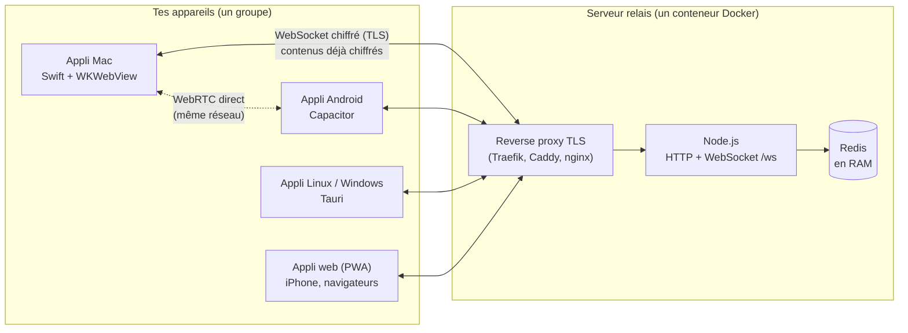
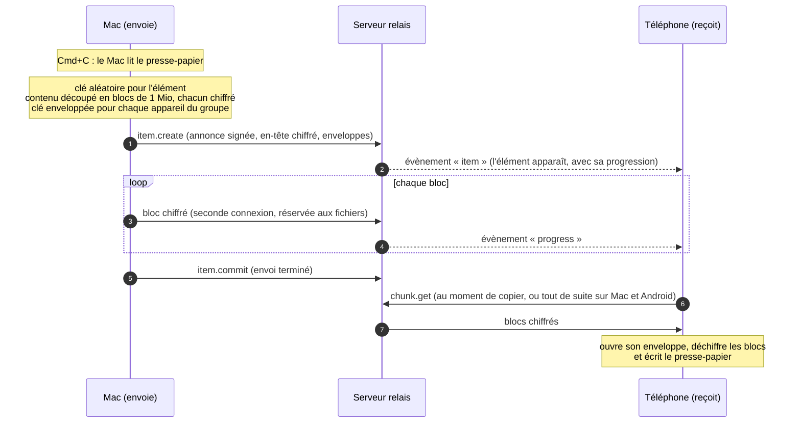
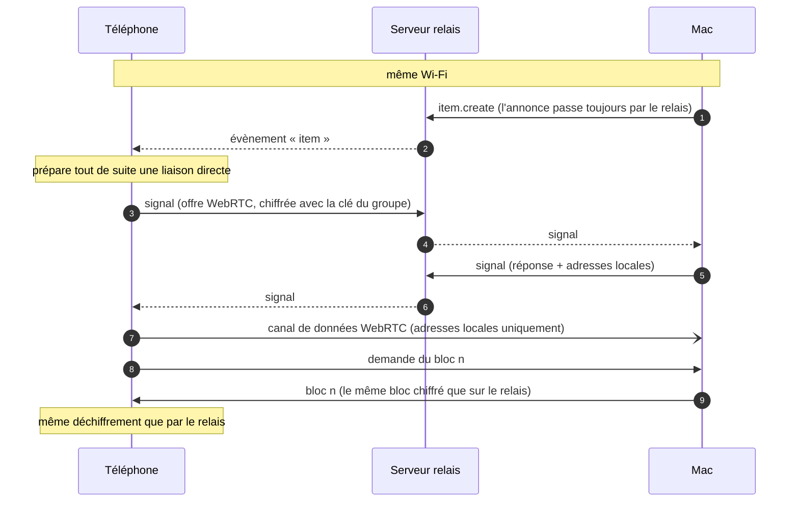
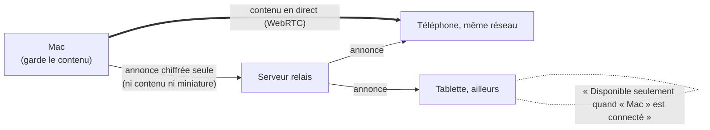
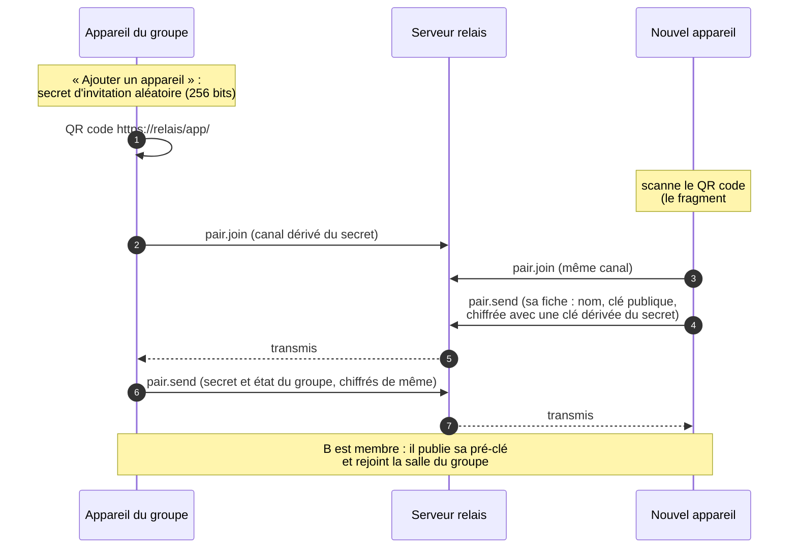
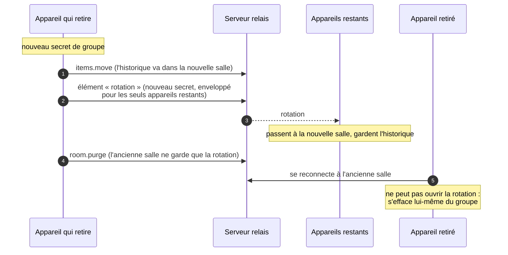

# Comment ça marche

Entre Nous relie les appareils d'une même personne : ce qui est copié sur l'un se colle sur
l'autre. Tout est chiffré sur l'appareil qui envoie et déchiffré sur celui qui reçoit ;
entre les deux, un **serveur relais** transmet des données qu'il ne peut pas lire, ou bien les
appareils s'échangent le contenu **en direct** quand ils sont sur le même réseau.

- [Les pièces](#les-pièces)
- [Envoi par le serveur relais](#envoi-par-le-serveur-relais)
- [Mode local : en direct sur le même réseau](#mode-local--en-direct-sur-le-même-réseau)
- [Associer un appareil](#associer-un-appareil)
- [Retirer un appareil](#retirer-un-appareil)
- [Historique, expiration, note](#historique-expiration-note)
- [Protocole du relais](#protocole-du-relais)

La sécurité (algorithmes, clés, ce que voit le serveur) est détaillée dans [securite.md](securite.md).

## Les pièces

- **Un seul cœur** (`web/src/core/`, TypeScript, sans DOM) : cryptographie, protocole, groupes,
  transferts. Il tourne dans le navigateur, dans les applis (qui embarquent la même interface)
  et dans Node pour les tests.
- **Les applis natives** ajoutent ce qu'un navigateur ne sait pas faire :

  | | Stockage des clés | Presse-papier | En plus |
  |---|---|---|---|
  | Mac | Trousseau (une seule entrée) | surveillé, écrit sans toucher | icône de barre des menus, glisser-déposer sur l'icône, notifications |
  | Linux, Windows | fichier chiffré, clé dans le trousseau du système | surveillé, écrit sans toucher | icône dans la zone de notification, notifications |
  | Android | chiffré par une clé du Keystore | écrit sans toucher | « Partager → Entre Nous », liens d'invitation |
  | Appli web | IndexedDB du navigateur | bouton « Envoyer le presse-papier », Ctrl+V | rien à installer |

- **Le relais** est volontairement simple : il range des blocs chiffrés en mémoire, prévient les
  appareils connectés, et efface tout à l'expiration. Il sert aussi la page d'accueil, l'appli
  web et les applis à télécharger.

## Envoi par le serveur relais

C'est le chemin par défaut : il marche partout (4G, Wi-Fi d'hôtel, réseau d'entreprise), sans
ouvrir de port sur la box, et l'appareil qui reçoit peut être éteint au moment de l'envoi.

- **Un élément** = une annonce signée par l'expéditeur, un en-tête chiffré (type, nom, taille,
  miniature, texte court), une enveloppe par appareil et les blocs du contenu.
- **Pendant l'envoi**, l'élément est déjà visible partout avec sa progression ; un appareil peut
  lancer le téléchargement avant la fin, il suit l'envoi.
- **Coupure** (veille, réseau) : l'envoi reprend avec les blocs manquants dès le retour de la
  connexion, tant que l'appli reste ouverte et que l'élément n'a pas expiré.
- **Appareil absent** : l'élément l'attend sur le relais jusqu'à son expiration (24 h par
  défaut) ; il le voit en ouvrant l'appli. Le partage automatique du presse-papier, lui,
  attend qu'un autre appareil soit connecté et envoie alors la dernière copie.

## Mode local : en direct sur le même réseau

Quand deux appareils du groupe sont sur le même réseau, le contenu passe **directement de l'un à
l'autre**, en WebRTC, sans passer par internet. C'est transparent : rien à régler.

- **Aucun serveur STUN ni TURN** : seules les adresses du réseau local sont échangées, la liaison
  ne peut donc se faire qu'en local, jamais par un tiers ni à travers internet.
- **Le relais sert de standard téléphonique** : il transmet les messages de mise en relation
  (chiffrés, sans les stocker) et garde l'historique et l'état du groupe. Il reste nécessaire
  même en mode local, au moins pour les annonces.
- **Ce qui passe sur la liaison** : exactement les mêmes blocs chiffrés que sur le relais, servis
  par l'appareil qui a envoyé l'élément (il les garde en mémoire tant qu'il est ouvert).
- **Si la liaison échoue** (autre réseau, Wi-Fi invité qui isole les appareils, pare-feu), le
  relais prend la suite sans message. Un téléchargement commence par le relais et bascule en direct
  dès que la liaison est prête.
- **Débit** : jusqu'à 20–30 Mo/s entre deux ordinateurs, 7–10 Mo/s d'un téléphone en Wi-Fi vers
  un Mac (mesures de novembre 2026), contre le débit montant de la box par le relais.

### Réseau local uniquement

Un réglage du groupe pour que **rien ne sorte du réseau local**, textes compris :

- Le relais ne reçoit **aucun bloc** du contenu : seulement l'annonce chiffrée.
- Un élément n'est disponible que tant que son expéditeur est ouvert sur le même réseau ; ailleurs,
  il est affiché comme indisponible, sans boutons.
- Une fois le réglage désactivé, l'expéditeur peut envoyer un élément local au serveur, à la main,
  avec « Envoyer au serveur ». Ce n'est jamais automatique : certains contenus ne doivent pas sortir.

## Associer un appareil

- L'invitation vaut **3 minutes, pour un seul appareil**. N'importe quel membre peut inviter.
- Aucun compte : un groupe n'est qu'un secret partagé par ses appareils. Un appareil peut être
  dans plusieurs groupes indépendants.
- Sur iPhone, l'appli web doit d'abord être ajoutée à l'écran d'accueil (son stockage est séparé de
  celui de Safari), puis on scanne depuis l'appli.

## Retirer un appareil

- Les appareils restants **gardent l'historique** ; l'appareil retiré ne peut plus rien lire de ce
  qui est envoyé ensuite, ni de l'historique (déplacé hors de sa portée).
- Un groupe réduit à un seul appareil est dissous.
- Un appareil resté éteint pendant une rotation ne reçoit pas le nouveau secret : il faut l'associer
  de nouveau.

## Historique, expiration, note

- **Historique partagé** : chaque élément reste disponible sur tous les appareils jusqu'à son
  expiration ; n'importe quel appareil peut le copier, l'enregistrer ou le supprimer pour tous.
- **Réglages du groupe** (modifiables par n'importe quel membre) : durée de conservation (10 min,
  1 h, 24 h par défaut, 7 jours, plafonnée par le serveur), taille de l'historique (1, 10 ou
  illimitée), taille maximale du partage automatique, réseau local uniquement.
- **Expiration** : le relais efface un élément à l'heure dite ; il quitte l'historique local à la
  seconde. Les fichiers reçus par les applis de bureau sont effacés au même moment.
- **Note en direct** : un champ texte synchronisé à chaque frappe, chiffré comme le reste.
  « Envoyer » en fait un élément de l'historique, la note restant en place.

## Protocole du relais

WebSocket sur `/ws`. Requêtes JSON `{ rid, op, … }`, réponses `{ rid, ok, … }`, évènements
`{ ev, … }` ; les blocs voyagent en trames binaires. Un appareil ouvre une connexion pour les
messages et une seconde, réservée aux blocs, pour qu'un gros envoi ne retarde jamais le reste.

| Opérations | Rôle |
|---|---|
| `hello` | entre dans une salle (identifiant opaque dérivé du secret du groupe) |
| `state.put`, `prekey.put` | état du groupe (chiffré, versionné), pré-clés publiques des appareils |
| `item.create`, `chunk.put`, `chunk.have`, `item.commit`, `chunk.get` | envoi et lecture d'un élément |
| `item.delete`, `items.clear`, `items.trim`, `items.shorten` | suppression, taille de l'historique, rétention raccourcie |
| `note.put` | note en direct (dernière version seulement) |
| `item.publish` | un élément local envoyé au serveur |
| `signal` | mise en relation WebRTC (transmis, jamais stocké) |
| `items.move`, `room.purge`, `room.delete` | retrait d'un appareil, dissolution |
| `pair.join`, `pair.send`, `pair.leave` | canal d'association temporaire |

Évènements : `item`, `progress`, `presence`, `state`, `prekey`, `note`, `deleted`, `refresh`,
`gone`, `signal`, `pair`, `pair.peer`.

Limites : 200 requêtes/s par connexion, 32 connexions par adresse IP, blocs de 1 Mio.
Le relais ne journalise ni contenu ni identifiant de salle.
