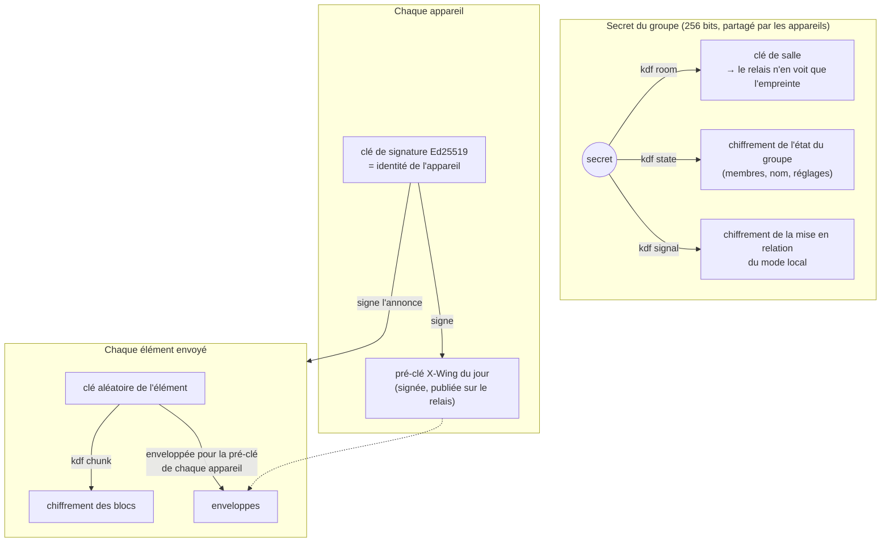
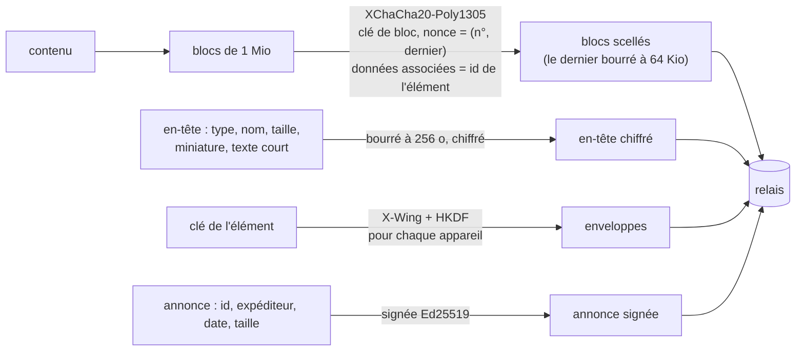

# Sécurité

L'idée de départ : **le serveur relais ne doit rien pouvoir lire**. Tout est chiffré sur l'appareil
qui envoie et ne se déchiffre que sur les appareils du groupe ; le relais transporte et range des
données opaques, en mémoire, jusqu'à leur expiration.

- [Ce que voit le serveur, ce qu'il ne voit pas](#ce-que-voit-le-serveur-ce-quil-ne-voit-pas)
- [Algorithmes](#algorithmes)
- [Les clés](#les-clés)
- [Chiffrement d'un élément](#chiffrement-dun-élément)
- [Stockage sur les appareils](#stockage-sur-les-appareils)
- [Le relais](#le-relais)
- [Limites et menaces connues](#limites-et-menaces-connues)
- [Signaler une faille](#signaler-une-faille)

## Ce que voit le serveur, ce qu'il ne voit pas

| Le relais ne voit jamais | Le relais voit |
|---|---|
| le contenu : textes, images, fichiers, note | les adresses IP des appareils connectés |
| les noms de fichiers, les miniatures, les types | l'heure des envois, leur nombre |
| le nom du groupe, le nom et le type des appareils | une taille approximative (arrondie à 64 Kio, 256 o pour l'en-tête) |
| le secret du groupe, les clés privées | un identifiant de salle opaque, des identifiants d'appareils pseudonymes |
| les adresses locales échangées pour le mode local | qui est connecté en ce moment (pour le partage automatique) |

Le relais ne journalise ni contenu ni identifiant de salle, et ne garde rien sur disque
(sauf option `PERSIST`, qui ne range que les mêmes données chiffrées).

## Algorithmes

Bibliothèques [`@noble`](https://paulmillr.com/noble/) (JavaScript pur, auditées), le même code
sur toutes les plateformes.

| Usage | Choix |
|---|---|
| Échange de clés | X25519 + ML-KEM-768 hybride (combinateur X-Wing) : résiste à un futur ordinateur quantique |
| Signatures | Ed25519 |
| Chiffrement | XChaCha20-Poly1305 (nonces de 192 bits) |
| Dérivation | HKDF-SHA-256, chaque usage étiqueté `entrenous/v1/<usage>` |
| Transport | TLS jusqu'au relais ; DTLS pour le mode local (WebRTC) ; en plus du chiffrement de bout en bout |

## Les clés

- **Le groupe** n'est qu'un secret de 256 bits, transmis lors de l'association par un canal chiffré
  avec un secret d'invitation à usage unique (le QR code). Il ne quitte jamais les appareils.
- **Chaque appareil** a sa clé de signature (son identité) et publie pour chaque groupe une pré-clé
  X-Wing signée, **renouvelée chaque jour**. Une ancienne pré-clé est détruite après son remplacement
  plus la durée de conservation du groupe : un vol de l'appareil ne permet pas de relire ce qui a déjà
  expiré (confidentialité persistante, à la journée près).
- **L'association** passe par un lien `https://relais/app/#p=<secret>` : le fragment après `#` n'est
  jamais envoyé au serveur, et la page l'efface aussitôt. Invitation valable 3 minutes, pour un seul
  appareil.
- **Le retrait d'un appareil** remplace le secret du groupe ; le nouveau secret n'est enveloppé que
  pour les appareils restants, et l'historique est déplacé dans une salle que l'appareil retiré ne
  connaît pas.

## Chiffrement d'un élément

- Le contenu est chiffré **une seule fois** ; seule la clé est enveloppée pour chaque appareil
  (construction proche de HPKE).
- Chaque bloc est authentifié avec son numéro, l'identifiant de l'élément et un drapeau « dernier » :
  un relais malveillant ne peut ni réordonner, ni tronquer, ni mélanger les blocs de deux éléments.
- L'annonce est signée par l'appareil expéditeur ; les autres vérifient la signature avec la clé
  d'un membre connu du groupe.
- **Mode local** : ce sont les mêmes blocs scellés qui passent sur la liaison directe. Les messages
  de mise en relation (adresses locales comprises) sont chiffrés avec la clé du groupe et liés à
  l'expéditeur et au destinataire.

## Stockage sur les appareils

| Plateforme | Où sont les clés |
|---|---|
| Mac | Trousseau de session (une seule entrée), lisible par cette appli seulement |
| Android | chiffrées par une clé AES-GCM du Keystore Android, jamais extractible ; sauvegarde cloud désactivée |
| Windows | fichier chiffré (XChaCha20-Poly1305) dans `%APPDATA%`, clé dans le Gestionnaire d'identification |
| Linux | fichier chiffré dans `~/.local/share`, clé dans le Secret Service (GNOME Keyring, KWallet) ; à défaut, dans un fichier lisible par l'utilisateur seul (plus faible) |
| Appli web | IndexedDB du navigateur, protégée par la session de l'utilisateur |

- Ce que les applis de bureau écrivent dans le presse-papier est marqué « secret » (`ConcealedType`
  sur Mac, formats d'exclusion sur Windows, indication KDE sur Linux) : les historiques de
  presse-papier l'ignorent. À l'inverse, ce que les gestionnaires de mots de passe marquent ainsi
  n'est jamais partagé.
- Les fichiers reçus par les applis de bureau sont rangés dans le dossier temporaire de l'utilisateur
  et effacés à l'expiration de l'élément.
- Les notifications n'indiquent que le type et l'expéditeur (« Texte reçu de Pixel »), jamais le contenu.

## Le relais

- Un conteneur Node + Redis, **en mémoire** ; redémarrer le conteneur efface tout.
- Conteneur en lecture seule, sans privilèges (`cap_drop: ALL`, `no-new-privileges`), utilisateur
  non root, nombre de processus limité.
- Redis : mot de passe aléatoire à chaque démarrage, joignable seulement depuis le conteneur.
- En-têtes stricts sur les pages servies : CSP sans script en ligne ni `eval` (Alpine.js en build CSP),
  `frame-ancestors 'none'`, HSTS, `no-referrer`.
- Limites : 200 requêtes/s par connexion, 32 connexions par adresse IP, quota de stockage.

## Limites et menaces connues

- **Appli web** : son code est servi par le relais. Un relais compromis pourrait servir un code
  malveillant à l'appli web, qui verrait alors ce qu'on y fait (limite de toute appli web). Les applis
  Mac, Android, Linux et Windows embarquent leur interface : le code ne vient jamais du serveur.
- **Disponibilité** : le relais peut refuser, retarder ou supprimer des éléments. Il ne peut pas en
  fabriquer ni en lire.
- **Métadonnées** : voir le tableau plus haut (IP, heures, tailles approximatives, présence).
- **Appareil compromis** : un appareil du groupe lit tout ce que le groupe partage tant qu'il en fait
  partie. Le retirer depuis un autre appareil coupe son accès à la suite et à l'historique.
- **Signatures** : Ed25519 n'est pas post-quantique. Cela ne concerne qu'une attaque active, au moment
  même de l'envoi ; le contenu, lui, est protégé par X-Wing.
- **Applis non signées par un éditeur reconnu** : appli Mac non notariée, APK installé hors du Play Store,
  appli Windows non signée (avertissement SmartScreen). Vérifie que tu les télécharges depuis ton relais
  ou depuis les versions publiées sur GitHub.
- **Pas d'audit indépendant** à ce jour. Le code est public : chacun peut le vérifier.

## Signaler une faille

Merci de ne pas ouvrir d'issue publique : utilise **« Report a vulnerability »** dans l'onglet
*Security* du dépôt GitHub (signalement privé). Voir [SECURITY.md](../SECURITY.md).
