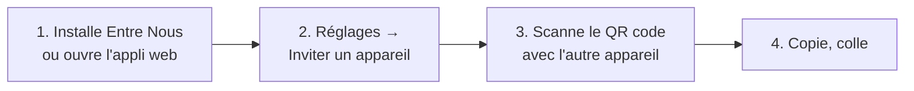

# Utiliser Entre Nous

Copie sur un appareil, colle sur un autre. Pas de compte : tes appareils forment un **groupe**,
associé par QR code.

## 1. Installer

| Appareil | Comment |
|---|---|
| Mac | télécharge le zip depuis la page d'accueil, glisse **Entre Nous** dans Applications ; l'appli se loge dans la barre des menus |
| Android | télécharge l'APK et ouvre-le (Android demande d'autoriser l'installation) |
| Linux | paquet `.deb` (Debian, Ubuntu…) ou `.AppImage` (toute distribution) ; icône dans la zone de notification |
| Windows | installeur `.exe` ; icône dans la zone de notification |
| iPhone, iPad | ouvre l'appli web dans Safari, puis **Partager → Sur l'écran d'accueil**, et lance-la depuis cette icône |
| Autre | l'appli web, dans tout navigateur récent |

Au premier lancement, un ordinateur crée tout seul un groupe « Mes appareils ».

## 2. Associer tes appareils

1. Sur un appareil déjà associé : **Réglages → Inviter un appareil**. Un QR code s'affiche
   (valable 3 minutes, pour un seul appareil).
2. Sur le nouvel appareil : scanne-le avec l'appareil photo (ou **Scanner un QR code** dans l'appli).
   Sur un ordinateur sans caméra, colle le lien d'invitation dans **Rejoindre**.
3. C'est fait : les deux appareils apparaissent dans **Réglages → Appareils**.

Tu peux créer d'autres groupes (un pour la famille, un pour le travail) : ils sont indépendants.

## 3. Envoyer

| | Comment envoyer |
|---|---|
| Mac, Linux, Windows | **copie, c'est tout** : ce que tu copies part tout seul dès qu'un autre appareil est connecté ; un fichier copié dans le gestionnaire de fichiers aussi. Bouton **Fichier**, ou glisse un fichier dans la fenêtre (sur Mac, sur l'icône de la barre des menus) |
| Android | **Envoyer le presse-papier**, **Fichier**, ou **Partager → Entre Nous** depuis n'importe quelle appli |
| iPhone | **Envoyer le presse-papier** (touche « Coller » dans la bulle), **Fichier** |
| Navigateur | Ctrl+V dans la page, glisser-déposer, **Fichier** |

- **Note** : le champ texte en haut se synchronise à chaque frappe sur tous les appareils.
  **Envoyer** l'ajoute à l'historique, la note restant en place.
- **Pause** (ordinateurs) : bouton ⏸ ou menu de l'icône. Plus rien n'est lu ni envoyé tant que
  la pause dure ; les copies faites pendant ce temps ne partent jamais.
- **Limite du partage automatique** (réglage du groupe, 1 Mo par défaut) : au-delà, le contenu
  n'est pas envoyé tout seul, passe par **Fichier**. Un envoi manuel n'a pas de limite.

## 4. Recevoir

- **Mac, Linux, Windows, Android** : ce qui arrive est mis directement dans le presse-papier.
  Colle. Un fichier reçu par un ordinateur se colle aussi dans le gestionnaire de fichiers.
- **iPhone** : touche **Copier** sur l'élément (iOS n'autorise pas l'écriture sans geste).
- **Historique** : tout ce qui a été partagé reste disponible jusqu'à expiration, sur tous les
  appareils : **Copier**, **Enregistrer**, **Partager**, ou supprimer (pour tous).
- Un gros fichier apparaît dès le début de son envoi, avec sa progression et sa vitesse ; tu peux
  lancer le téléchargement avant la fin, il suit l'envoi.
- **Notifications** (ordinateurs) : quand la fenêtre est fermée, « Texte reçu de Pixel », jamais
  le contenu. Réglage **Notification à la réception**.

## 5. Réglages du groupe

Modifiables par n'importe quel appareil du groupe :

| Réglage | Choix |
|---|---|
| Durée de conservation sur le serveur | 10 min, 1 h, 24 h (défaut), 7 jours ; passé ce délai, tout s'efface |
| Taille de l'historique | 1, 10 (défaut) ou illimitée |
| Partage automatique jusqu'à | 1 Mo (défaut), 10 Mo, 100 Mo |
| Réseau local uniquement | le contenu passe directement d'un appareil à l'autre, jamais par le serveur relais |

**Transferts directs** : quand deux appareils sont sur le même réseau, le contenu passe de l'un à
l'autre sans internet, automatiquement (« · en direct vers Pixel » s'affiche). Avec **Réseau local
uniquement**, un élément n'est disponible que tant que son expéditeur est connecté sur le même
réseau ; une fois le réglage désactivé, **Envoyer au serveur** permet de le confier au relais, à la main.

## 6. Utiliser ton propre serveur

Dans les applis : **Réglages → Serveur → Adresse du serveur**, puis **Changer de serveur**.
Voir [deploiement.md](deploiement.md) pour héberger un serveur relais.

## 7. Perdre ou retirer un appareil

**Réglages → Appareils → Retirer**, depuis n'importe quel autre appareil du groupe. Les clés de
chiffrement sont renouvelées : l'appareil retiré perd l'accès à tout ce que tu partages, historique
compris ; les autres le gardent. **Quitter** fait la même chose pour l'appareil sur lequel tu es.
