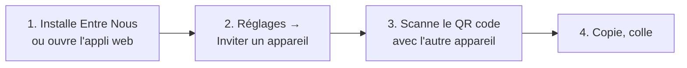
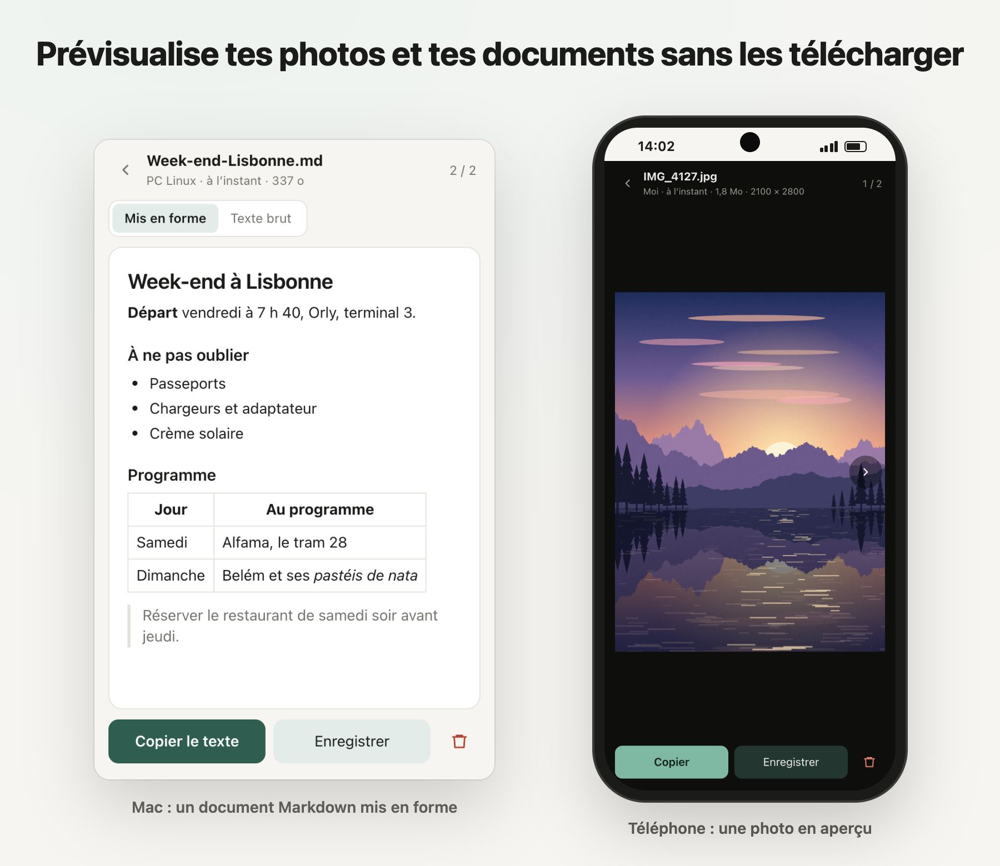

# Utiliser Entre Nous
[English](en/usage.md)

Copie sur un appareil, colle sur un autre. Pas de compte : tes appareils forment un **groupe**,
associé par QR code.

## 1. Installer

| Appareil | Comment |
|---|---|
| Mac | télécharge le zip depuis la page d'accueil, glisse **Entre Nous** dans Applications ; l'appli se loge dans la barre des menus |
| Android | télécharge l'APK et ouvre-le (Android demande d'autoriser l'installation) |
| Linux | paquet `.deb` (Debian, Ubuntu…) ou `.AppImage` (toute distribution) ; icône dans la zone de notification |
| Windows | installeur `.exe` ; icône dans la zone de notification |
| iPhone, iPad | ouvre l'appli web dans Safari, puis **Partager → Sur l'écran d'accueil**, et lance-la depuis cette icône |
| Autre | l'appli web, dans tout navigateur récent |
| Terminal | `entrenous`, en ligne de commande (Node.js 22) : voir [Entre Nous en ligne de commande](cli.md) |

Au premier lancement, un ordinateur crée tout seul un groupe « Mes appareils ».

## 2. Associer tes appareils

1. Sur un appareil déjà associé : **Réglages → Inviter un appareil**. Un QR code s'affiche
   (valable 3 minutes, pour un seul appareil).
2. Sur le nouvel appareil : scanne-le avec l'appareil photo (ou **Scanner un QR code** dans l'appli),
   ou colle le lien d'invitation affiché sous le QR code dans **Rejoindre** (sur l'écran d'accueil,
   ou dans les Réglages) : pratique sur un ordinateur sans caméra, ou pour envoyer le lien à
   distance par une messagerie.
3. C'est fait : les deux appareils apparaissent dans **Réglages → Appareils**.

Tu peux créer d'autres groupes (un pour la famille, un pour le travail) : ils sont indépendants.

## 3. Envoyer

| | Comment envoyer |
|---|---|
| Mac, Linux, Windows | **copie, c'est tout** : ce que tu copies part tout seul dès qu'un autre appareil est connecté ; un fichier copié dans le gestionnaire de fichiers aussi. Bouton **Fichier**, ou glisse un fichier dans la fenêtre (sur Mac, sur l'icône de la barre des menus) |
| Android | **Envoyer le presse-papier**, **Fichier**, ou **Partager → Entre Nous** depuis n'importe quelle appli |
| iPhone | **Envoyer le presse-papier** (touche « Coller » dans la bulle), **Fichier** |
| Navigateur | Ctrl+V dans la page, glisser-déposer, **Fichier** |

- **Note** : le champ texte en haut se synchronise à chaque frappe sur tous les appareils.
  **Envoyer** l'ajoute à l'historique, la note restant en place.
- **Pause** (ordinateurs) : bouton ⏸ ou menu de l'icône. Plus rien n'est lu ni envoyé tout seul
  tant que la pause dure ; les copies faites pendant ce temps ne partent jamais. Pour envoyer
  quand même ce que tu viens de copier : **Envoyer le presse-papier** (ou Cmd/Ctrl+V dans la
  fenêtre), comme quand le partage automatique est désactivé dans les Réglages (le bouton ⏸
  disparaît alors).
- **Limite du partage automatique** (réglage du groupe, 1 Mo par défaut) : au-delà, le contenu
  n'est pas envoyé tout seul, passe par **Fichier**. Un envoi manuel n'a pas de limite.

## 4. Recevoir

- **Mac, Linux, Windows, Android** : ce qui arrive est mis directement dans le presse-papier.
  Colle. Un fichier reçu par un ordinateur se colle aussi dans le gestionnaire de fichiers.
- **iPhone** : touche **Copier** sur l'élément (iOS n'autorise pas l'écriture sans geste).
- **Historique** : tout ce qui a été partagé reste disponible jusqu'à expiration, sur tous les
  appareils : **Copier**, **Enregistrer**, **Partager**, ou **Supprimer** (pour tous : la
  confirmation dit « Supprimer partout »). **Tout supprimer** vide l'historique et la note.
- **Envoi en cours** : une ligne « ↑ nom » au-dessus de l'historique montre sa progression et sa
  vitesse, sur tous les appareils, et disparaît à la fin. L'élément apparaît dès le début :
  **Enregistrer** est possible avant la fin, le téléchargement suit l'envoi ; **Copier** arrive une
  fois l'envoi terminé (les applis le copient alors d'elles-mêmes). Sans nouvelles de l'expéditeur
  pendant 5 minutes, l'élément est marqué « envoi interrompu ».
- **Téléchargement** : sa progression s'affiche dans l'élément, à la place des boutons.

### Aperçus

Une photo, une vidéo, un fichier audio, un texte ou un fichier Markdown s'ouvrent dans l'appli, sans
les enregistrer : touche la vignette, ou **Voir** (image), **Lire** (vidéo), **Écouter** (audio),
**Ouvrir** (texte, Markdown). Les flèches
(ou un glissement sur téléphone, ← → au clavier) passent d'un élément à l'autre ; Échap ferme.

- **Dans l'historique, avant tout téléchargement** : la vignette d'une photo, l'image et la durée
  d'une vidéo, la durée d'un fichier audio, les premiers mots d'un texte. L'appareil qui envoie les prépare et les joint,
  chiffrés, à l'élément ; le serveur n'en voit rien. Une vignette ne garde aucune métadonnée de la
  photo (lieu, appareil) ; le fichier lui-même part tel quel. En mode « Réseau local uniquement »,
  rien de tout ça ne passe par le serveur : l'élément s'affiche sans aperçu.
- **Vidéo** : elle se lit pendant qu'elle arrive, sans être téléchargée en entier, et on peut avancer
  ou reculer à tout moment (même pendant que l'autre appareil l'envoie encore). MP4 et MOV (ceux
  des téléphones) ; les autres formats, ou un iPhone plus ancien qu'iOS 17.1, la téléchargent
  d'abord. Un format que l'appareil ne sait pas lire (HEVC sur certains PC, par exemple) propose
  **Enregistrer**.
- **Audio** : il s'écoute pendant qu'il arrive, sans être téléchargé en entier, et on peut avancer
  ou reculer à tout moment. MP3, M4A, Opus, FLAC et WAV (8, 16 ou 24 bits) ; les autres formats
  (Ogg Vorbis, WAV en virgule flottante…) se téléchargent d'abord, puis s'écoutent si l'appareil
  sait les lire.
- **Regarder en incrustation** (picture-in-picture) : la vidéo continue dans une petite fenêtre
  au-dessus des autres.
  - **Mac** : celle du système, qui continue quand la fenêtre d'Entre Nous se ferme ; elle la
    rouvre quand on en revient.
  - **Android** : l'appli devient la petite fenêtre, avec un bouton lecture/pause ; quitter l'appli
    pendant une lecture l'y met aussi (Android 8 et plus).
  - **Linux, Windows** : la fenêtre se réduit à la vidéo, dans le coin de l'écran, au premier plan ;
    le bouton en haut à gauche (au survol) la remet en grand.
  - **Navigateurs** : Chrome, Edge et Safari (Mac, iPhone).
- **Texte** : avec ses numéros de ligne, et **Retour à la ligne** ; jusqu'au premier Mo du fichier
  (**Enregistrer** pour le reste). **Copier le texte** copie ce qui est affiché.
- **Markdown** : **Mis en forme** ou **Texte brut**. Le fichier vient d'un autre appareil : le HTML
  qu'il contient s'affiche comme du texte, ses images ne sont pas chargées (elles diraient à leur
  serveur qui lit le fichier), et seuls les liens web et e-mail restent cliquables.

- **Confirmations** : **Demander confirmation avant de supprimer** (réglage de l'appareil) vaut pour
  les éléments et pour **Effacer** la note ; un bouton de confirmation revient à la normale au
  bout de quelques secondes.
- **Notifications** (ordinateurs) : quand la fenêtre est fermée, « Texte reçu de Pixel », jamais
  le contenu. Réglage **Notification à la réception**.
- **Ouvrir à l'ouverture de session** (ordinateurs) : l'appli démarre avec la session, directement
  dans la barre des menus ou la zone de notification.
- **Nouvelle version** : les applis installées l'annoncent (« Nouvelle version disponible ») avec
  un lien de téléchargement ; l'appli web, elle, se met à jour toute seule.

## 5. Réglages du groupe

Modifiables par n'importe quel appareil du groupe :

| Réglage | Choix |
|---|---|
| Durée de conservation sur le serveur | 10 min, 1 h, 24 h (défaut), 7 jours ; passé ce délai, tout s'efface |
| Taille de l'historique | 1, 10 (défaut) ou illimitée |
| Partage automatique jusqu'à | 1 Mo (défaut), 10 Mo, 100 Mo |
| Réseau local uniquement | le contenu passe directement d'un appareil à l'autre, jamais par le serveur relais |

**Transferts directs** : quand deux appareils sont sur le même réseau, le contenu passe de l'un à
l'autre sans internet, automatiquement (« · en direct vers Pixel » s'affiche). Avec **Réseau local
uniquement**, un élément n'est disponible que tant que son expéditeur est connecté sur le même
réseau ; une fois le réglage désactivé, **Envoyer au serveur** permet de le confier au relais, à la main.

**Langue** : l'appli suit la langue du système ou du navigateur (français ou anglais, l'anglais
pour les autres langues) ; **Réglages → Langue** permet de la changer.

## 6. Utiliser ton propre serveur

Dans les applis : **Réglages → Serveur → Adresse du serveur**, puis **Changer de serveur**.
Voir [deploiement.md](deploiement.md) pour héberger un serveur relais.

## 7. Perdre ou retirer un appareil

**Réglages → Appareils → Retirer**, depuis n'importe quel autre appareil du groupe. Les clés de
chiffrement sont renouvelées : l'appareil retiré perd l'accès à tout ce que tu partages, historique
compris ; les autres le gardent. **Quitter** fait la même chose pour l'appareil sur lequel tu es.
Un groupe qui n'a plus qu'un appareil est dissous : celui qui reste repart sans groupe.
