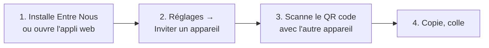
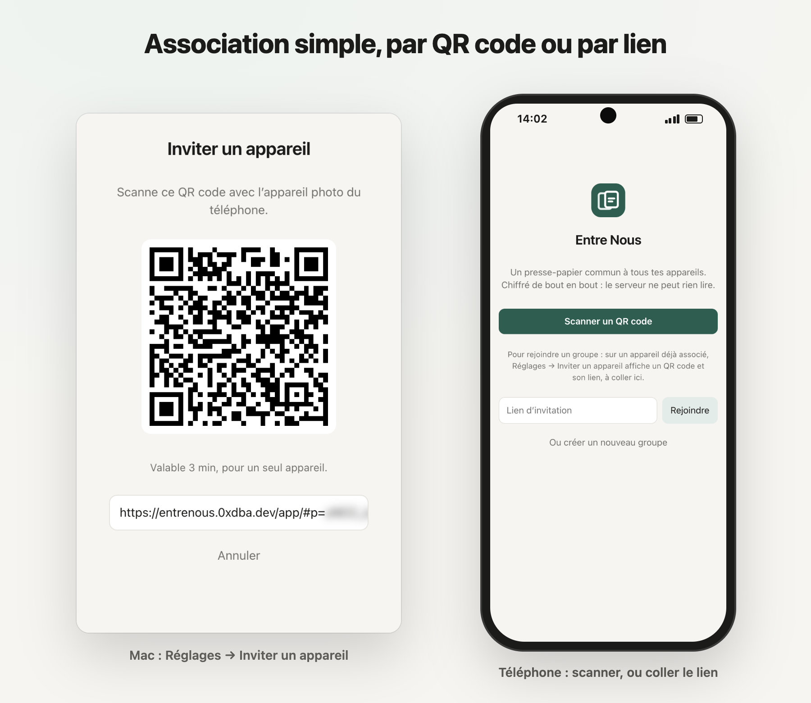
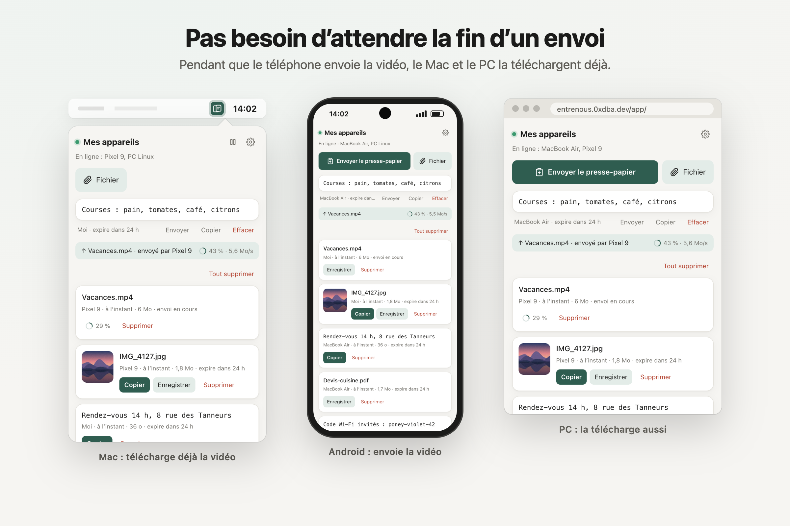
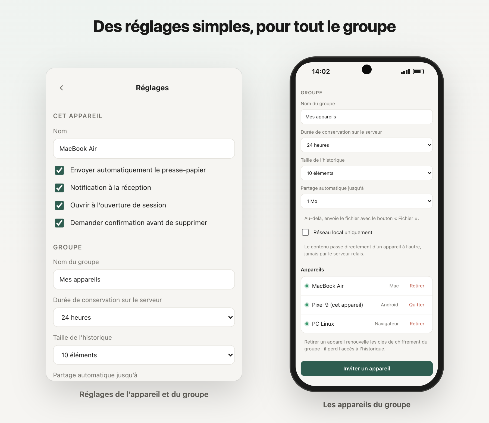

# Utiliser Entre Nous
[English](en/usage.md)

Copie sur un appareil, colle sur un autre. Pas de compte : tes appareils forment un **groupe**,
associé par QR code.

## 1. Installer

| Appareil | Comment |
|---|---|
| Mac | télécharge le zip depuis la page d'accueil, glisse **Entre Nous** dans Applications ; l'appli se loge dans la barre des menus |
| Android | télécharge l'APK et ouvre-le (Android demande d'autoriser l'installation) |
| Linux | paquet `.deb` (Debian, Ubuntu…) ou `.AppImage` (toute distribution) ; icône dans la zone de notification |
| Windows | installeur `.exe` ; icône dans la zone de notification |
| iPhone, iPad | ouvre l'appli web dans Safari, puis **Partager → Sur l'écran d'accueil**, et lance-la depuis cette icône |
| Autre | l'appli web, dans tout navigateur récent |
| Terminal | `entrenous`, en ligne de commande (Node.js 22) : voir [Entre Nous en ligne de commande](cli.md) |

Au premier lancement, un ordinateur crée tout seul un groupe « Mes appareils ».

## 2. Associer tes appareils

1. Sur un appareil déjà associé : **Réglages → Inviter un appareil**. Un QR code s'affiche
   (valable 3 minutes, pour un seul appareil).
2. Sur le nouvel appareil : scanne-le avec l'appareil photo (ou **Scanner un QR code** dans l'appli),
   ou colle le lien d'invitation affiché sous le QR code dans **Rejoindre** (sur l'écran d'accueil,
   ou dans les Réglages) : pratique sur un ordinateur sans caméra, ou pour envoyer le lien à
   distance par une messagerie.
3. C'est fait : les deux appareils apparaissent dans **Réglages → Appareils**.

Tu peux créer d'autres groupes (un pour la famille, un pour le travail) : ils sont indépendants.

## 3. Envoyer

| | Comment envoyer |
|---|---|
| Mac, Linux, Windows | **copie, c'est tout** : ce que tu copies est envoyé tout seul, même si aucun autre appareil n'est connecté ; un fichier copié dans le gestionnaire de fichiers aussi. Boutons **Fichier** et **Dossier**, ou glisse un fichier ou un dossier dans la fenêtre (sur Mac, sur l'icône de la barre des menus) |
| Android | **Envoyer le presse-papier**, **Fichier** (des fichiers, ou un dossier), ou **Partager → Entre Nous** depuis n'importe quelle appli |
| iPhone | **Envoyer le presse-papier** (touche « Coller » dans la bulle), **Fichier** |
| Navigateur | Ctrl+V dans la page, glisser-déposer, **Fichier** ; **Dossier** sur ordinateur |

- **Note** : le champ texte en haut se synchronise à chaque frappe sur tous les appareils.
  **Envoyer** l'ajoute à l'historique, la note restant en place.
- **Pause** (ordinateurs) : bouton ⏸ ou menu de l'icône. Plus rien n'est lu ni envoyé tout seul
  tant que la pause dure ; les copies faites pendant ce temps ne partent jamais. Pour envoyer
  quand même ce que tu viens de copier : **Envoyer le presse-papier** (ou Cmd/Ctrl+V dans la
  fenêtre), comme quand le partage automatique est désactivé dans les Réglages (le bouton ⏸
  disparaît alors).
- **Limite du partage automatique** (réglage du groupe, 1 Mo par défaut) : au-delà, le contenu
  n'est pas envoyé tout seul, passe par **Fichier**. Un envoi manuel n'a pas de limite.

### Envoyer un dossier

Un dossier s'envoie comme un fichier : bouton **Dossier** sur ordinateur, **Fichier → Un dossier…**
dans l'appli Android, ou glisse-le dans la fenêtre (sur Mac, sur l'icône de la barre des menus
aussi). Il arrive dans l'historique en un seul élément, avec tous ses sous-dossiers.

- **Plus de 10 fichiers ou plus de 40 Mo** : l'appli te montre d'abord ce qu'il contient, et la
  place libre sur le serveur ; **Envoyer** le fait partir.
- **Copié dans le Finder ou l'Explorateur** : un petit dossier part tout seul, comme un fichier ;
  un plus gros attend ton accord (une notification te prévient).
- **Fichiers système** (.DS_Store, Thumbs.db, desktop.ini) : laissés de côté. Les autres fichiers
  cachés partent.
- **Aperçus** : l'appareil qui envoie prépare un aperçu de chaque photo, vidéo et PDF ; pour un gros
  dossier, ça prend quelques secondes (« Préparation » au-dessus de l'historique).
- Un iPhone, ou le navigateur d'un téléphone, ne sait pas choisir un dossier : il les reçoit, mais
  n'en envoie pas (l'appli Android, si).

## 4. Recevoir

- **Mac, Linux, Windows, Android** : ce qui arrive est mis directement dans le presse-papier.
  Colle. Un fichier reçu par un ordinateur se colle aussi dans le gestionnaire de fichiers.
- **iPhone** : touche **Copier** sur l'élément (iOS n'autorise pas l'écriture sans geste).
- **Historique** : tout ce qui a été partagé reste disponible jusqu'à expiration, sur tous les
  appareils : **Copier**, **Enregistrer**, **Partager**, ou **Supprimer** (pour tous : la
  confirmation dit « Supprimer partout »). **Tout supprimer** vide l'historique et la note.
- **Accusés de réception** : des coches en haut à droite de chaque élément. Une coche : un
  appareil l'a reçu ; deux : tous l'ont reçu (tous ceux du groupe, sauf celui qui l'a envoyé). Elles se colorent quand l'élément est lu
  (ouvert, copié ou enregistré) : la première dès qu'un appareil l'a lu, la seconde quand tous
  l'ont lu. Touche les coches pour voir où en est chaque appareil. La copie automatique dans le
  presse-papier ne compte pas comme une lecture. Dans un groupe de deux, l'élément reçu n'en a pas :
  elles ne diraient que ce que tu as fait.
- **Épingler** : la punaise d'un élément le garde en haut de l'historique, sur tous les appareils,
  et aussi en haut des résultats de recherche. Il expire quand même à son heure, mais il n'est pas
  supprimé quand le groupe garde un nombre limité d'éléments. Si l'élément est plus ancien que ceux
  que le groupe garde, le désépingler le supprime : l'appli le demande d'abord.
- **Liens** : un texte qui contient un lien a un bouton **Ouvrir**, qui l'ouvre dans le navigateur.
- **QR code** : l'icône QR code d'un texte court, ou d'un petit fichier texte, l'affiche en QR code.
  Pratique pour donner le mot de passe du Wi-Fi à un invité : il le scanne avec l'appareil photo de
  son téléphone, sans rien installer. Le QR code est fait sur l'appareil, rien ne passe par Internet.
- **Envoi en cours** : une ligne « ↑ nom » au-dessus de l'historique montre sa progression et sa
  vitesse, sur tous les appareils, et disparaît à la fin. L'élément apparaît dès le début :
  **Enregistrer** est possible avant la fin, le téléchargement suit l'envoi ; **Copier** arrive une
  fois l'envoi terminé (les applis le copient alors d'elles-mêmes). Sans nouvelles de l'expéditeur
  pendant 5 minutes, l'élément est marqué « envoi interrompu ».
- **Téléchargement** : sa progression s'affiche dans l'élément, à la place des boutons.

### Aperçus

Une photo, une vidéo, un fichier audio, un PDF, un texte ou un fichier Markdown s'ouvrent dans
l'appli, sans les enregistrer : touche la vignette, ou **Voir** (image), **Lire** (vidéo), **Écouter**
(audio), **Ouvrir** (PDF, texte, Markdown). Les flèches (ou un glissement sur téléphone, ← → au
clavier) passent d'un élément à l'autre ; Échap ferme.

- **Dans l'historique, avant tout téléchargement** : l'aperçu d'une photo, l'image et la durée
  d'une vidéo, la durée d'un fichier audio, la première page et le nombre de pages d'un PDF, les
  premiers mots d'un texte. L'appareil qui envoie les prépare et les joint,
  chiffrés, à l'élément ; le serveur n'en voit rien. Un aperçu ne garde aucune métadonnée de la
  photo (lieu, appareil) ; le fichier lui-même part tel quel. En mode « Réseau local uniquement »,
  rien de tout ça ne passe par le serveur : l'élément s'affiche sans aperçu.
- **Photo** : tu la vois en grand tout de suite, sans la télécharger. Elle ne se télécharge que si
  tu la copies ou l'enregistres. JPEG, PNG, GIF, WebP, AVIF et SVG ont un aperçu depuis tous les
  appareils ; les photos HEIC et les TIFF, quand elles viennent d'un iPhone ou d'un Mac. Une photo
  que l'appareil qui l'envoie ne sait pas lire (une photo HEIC envoyée depuis Chrome) arrive sans
  aperçu : enregistre-la pour l'ouvrir.
- **Vidéo** : elle se lit pendant qu'elle arrive, sans être téléchargée en entier, et on peut avancer
  ou reculer à tout moment (même pendant que l'autre appareil l'envoie encore). MP4 et MOV (ceux
  des téléphones) ; les autres formats, ou un iPhone plus ancien qu'iOS 17.1, la téléchargent
  d'abord. Un format que l'appareil ne sait pas lire (HEVC sur certains PC, par exemple) propose
  **Enregistrer**.
- **Audio** : il s'écoute pendant qu'il arrive, sans être téléchargé en entier, et on peut avancer
  ou reculer à tout moment. MP3, M4A, Opus, FLAC et WAV (8, 16 ou 24 bits) ; les autres formats
  (Ogg Vorbis, WAV en virgule flottante…) se téléchargent d'abord, puis s'écoutent si l'appareil
  sait les lire.
- **PDF** : ses pages défilent, chacune affichée en arrivant à l'écran ; seules les parties du
  fichier dont elles ont besoin sont téléchargées. **−** et **+** zooment, le pourcentage revient à
  la largeur de l'écran. Son texte se sélectionne, et **Copier la sélection** le copie ; ses liens
  web (http, https, mailto) s'ouvrent dans le navigateur, ses liens internes mènent à leur page. Les
  images JPEG 2000, rares, ne s'affichent pas.
- **Regarder en incrustation** (picture-in-picture) : la vidéo continue dans une petite fenêtre
  au-dessus des autres.
  - **Mac** : celle du système, qui continue quand la fenêtre d'Entre Nous se ferme ; elle la
    rouvre quand on en revient.
  - **Android** : l'appli devient la petite fenêtre, avec un bouton lecture/pause ; quitter l'appli
    pendant une lecture l'y met aussi (Android 8 et plus).
  - **Linux, Windows** : la fenêtre se réduit à la vidéo, dans le coin de l'écran, au premier plan ;
    le bouton en haut à gauche (au survol) la remet en grand.
  - **Navigateurs** : Chrome, Edge et Safari (Mac, iPhone).
- **Texte** : avec ses numéros de ligne, et **Retour à la ligne** ; jusqu'au premier Mo du fichier
  (**Enregistrer** pour le reste). **Copier le texte** copie ce qui est affiché.
- **Markdown** : **Mis en forme** ou **Texte brut**. Le fichier vient d'un autre appareil : le HTML
  qu'il contient s'affiche comme du texte, ses images ne sont pas chargées (elles diraient à leur
  serveur qui lit le fichier), et seuls les liens web et e-mail restent cliquables.

- **Confirmations** : **Demander confirmation avant de supprimer** (réglage de l'appareil) vaut pour
  les éléments et pour **Effacer** la note ; un bouton de confirmation revient à la normale au
  bout de quelques secondes.
- **Notifications** (ordinateurs) : quand la fenêtre est fermée, « Texte reçu de Pixel », jamais
  le contenu. Réglage **Notification à la réception**.
- **Ouvrir à l'ouverture de session** (ordinateurs) : l'appli démarre avec la session, directement
  dans la barre des menus ou la zone de notification.
- **Nouvelle version** : les applis installées l'annoncent (« Nouvelle version disponible ») avec
  un lien de téléchargement ; l'appli web, elle, se met à jour toute seule.

### Dossiers reçus

**Parcourir** ouvre le dossier, un niveau à la fois, sans rien télécharger. Un dossier qui ne
contient que des photos et des vidéos s'affiche en grille (**Liste** pour revenir à la liste).
Toucher un fichier l'ouvre dans l'aperçu habituel ; les flèches passent au fichier suivant du même
dossier. On peut le parcourir pendant qu'il est encore en cours d'envoi.

- **Télécharger une partie** : coche des fichiers ou des dossiers dans la liste (**Choisir** dans la
  grille), puis **Télécharger**. Sans rien cocher, le bouton du bas télécharge le dossier affiché ;
  **Tout télécharger**, dans l'historique ou à la racine du dossier, le prend en entier.
- **Où il arrive** : les applis (Mac, Linux, Windows, Android) te demandent où l'enregistrer et y
  recréent le dossier, tel quel ; Chrome et Edge sur ordinateur aussi. Ailleurs (Firefox, Safari,
  navigateurs des téléphones), il arrive en ZIP. Un seul fichier s'enregistre comme d'habitude.

### Rechercher

La loupe, en haut, ouvre la recherche (⌘F ou Ctrl+F sur ordinateur). Tape quelques lettres :
l'historique n'affiche plus que les éléments qui les contiennent, dans leur texte, le nom du
fichier, le début d'un fichier texte ou le nom de l'appareil. Les accents et les majuscules ne
comptent pas. Les puces sous le champ n'affichent qu'un type : textes, liens, images, vidéos,
audio, documents ou dossiers. Un dossier se trouve par son nom, pas par les fichiers qu'il contient.

Sur ordinateur, les flèches choisissent un résultat et Entrée le copie. Échap efface, puis ferme la
recherche. Tout se passe sur l'appareil : le serveur ne voit ni ce que tu cherches, ni le contenu.

## 5. Partager avec quelqu'un hors du groupe

Pour envoyer un élément de l'historique à quelqu'un qui n'a pas Entre Nous, touche son icône de
partage. Un lien et son QR code s'affichent tout de suite, valables 1 heure. La personne l'ouvre dans
son navigateur, sans compte ni installation : elle peut lire le texte, voir la photo, regarder la
vidéo, écouter la musique ou télécharger le fichier.

- **Durée** : 10 min, 1 h (par défaut), 24 h ou 7 jours, à changer sur la page du lien ; l'adresse
  du lien ne change pas. Le lien reste valable même si l'élément expire ou est supprimé du groupe
  avant lui.
- **Dans l'historique** : le lien apparaît, encadré de pointillés, sur l'appareil qui l'a créé
  seulement : **Copier le lien**, **QR code**, **Supprimer**. Un lien supprimé ne marche plus, tout
  de suite.
- **Chiffré de bout en bout** : la clé est dans le lien, après le `#`, et ne passe jamais par le
  serveur. Toute personne qui a le lien peut ouvrir l'élément : envoie-le seulement à qui doit le voir.
- **Un dossier** se partage de la même façon : la personne le parcourt dans son navigateur et
  télécharge ce qu'elle veut.
- Pas de lien en **Réseau local uniquement** : le contenu n'est pas sur le serveur.

### Recevoir des fichiers de quelqu'un hors du groupe

Pour récupérer les photos d'une soirée ou les fichiers d'un collègue, touche l'icône **Recevoir des
fichiers** en haut de l'écran. Un lien et son QR code s'affichent tout de suite, valables 24 heures.
La personne l'ouvre dans son navigateur, sans compte ni installation, écrit son prénom si elle veut,
et choisit ses fichiers : chacun part dès qu'il est choisi, et arrive dans l'historique de tous tes
appareils.

- **Message** : facultatif, il s'affiche sur la page (« Les photos de samedi »).
- **Durée** : 1 h, 24 h (par défaut) ou 7 jours, à changer sur la page du lien ; l'adresse ne change pas.
- **Dans l'historique** : plusieurs fichiers envoyés d'un coup forment un dossier (« Envoi de Marie »),
  un seul fichier reste un élément simple. Ils durent comme le reste de l'historique.
- **Sur tous tes appareils** : la demande apparaît en haut de l'historique, encadrée de pointillés :
  **Copier le lien**, **QR code**, **Supprimer**, depuis n'importe lequel. Une demande supprimée ne
  reçoit plus rien ; ce qui est déjà arrivé reste.
- **Chiffré de bout en bout** : la page chiffre les fichiers avant de les envoyer. Le lien permet
  d'envoyer, jamais de lire : la personne ne voit rien de ton historique, ni ce que les autres ont envoyé.
- Pas de demande en **Réseau local uniquement** : les fichiers passent par le serveur.

## 6. Réglages du groupe

Modifiables par n'importe quel appareil du groupe :

| Réglage | Choix |
|---|---|
| Durée de conservation sur le serveur | 10 min, 1 h, 24 h (défaut), 7 jours ; passé ce délai, tout s'efface |
| Taille de l'historique | 1, 10 (défaut) ou illimitée |
| Partage automatique jusqu'à | 1 Mo (défaut), 10 Mo, 100 Mo |
| Réseau local uniquement | le contenu passe directement d'un appareil à l'autre, jamais par le serveur relais |

**Transferts directs** : quand deux appareils sont sur le même réseau, le contenu passe de l'un à
l'autre sans internet, automatiquement (« · en direct vers Pixel » s'affiche). Avec **Réseau local
uniquement**, un élément n'est disponible que tant que son expéditeur est connecté sur le même
réseau ; une fois le réglage désactivé, **Envoyer au serveur** permet de le confier au relais, à la main.

**Langue** : l'appli suit la langue du système ou du navigateur (français ou anglais, l'anglais
pour les autres langues) ; **Réglages → Langue** permet de la changer.

## 7. Utiliser ton propre serveur

Dans les applis : **Réglages → Serveur → Adresse du serveur**, puis **Changer de serveur**.
Voir [deploiement.md](deploiement.md) pour héberger un serveur relais.

## 8. Perdre ou retirer un appareil

**Réglages → Appareils → Retirer**, depuis n'importe quel autre appareil du groupe. Les clés de
chiffrement sont renouvelées : l'appareil retiré perd l'accès à tout ce que tu partages, historique
compris ; les autres le gardent. **Quitter** fait la même chose pour l'appareil sur lequel tu es.
Un groupe qui n'a plus qu'un appareil est dissous : celui qui reste repart sans groupe.
